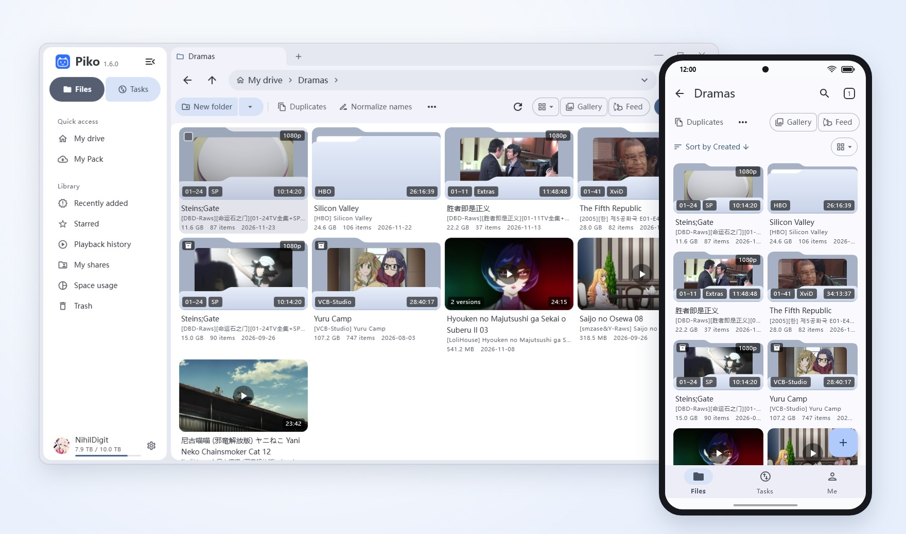
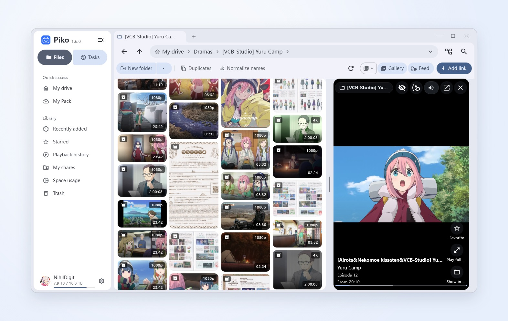
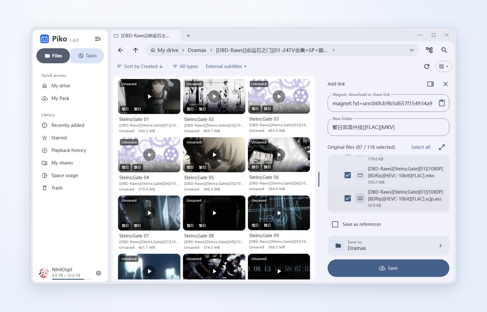
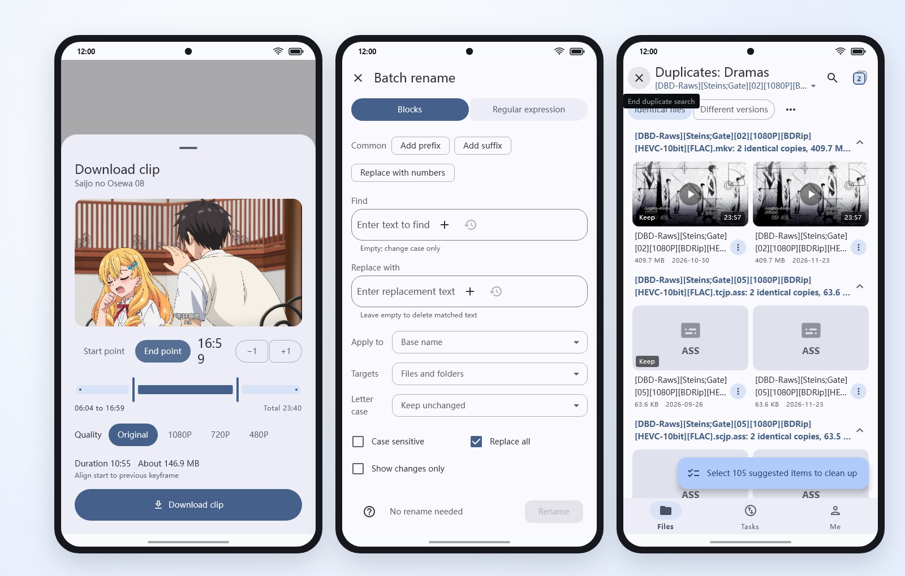
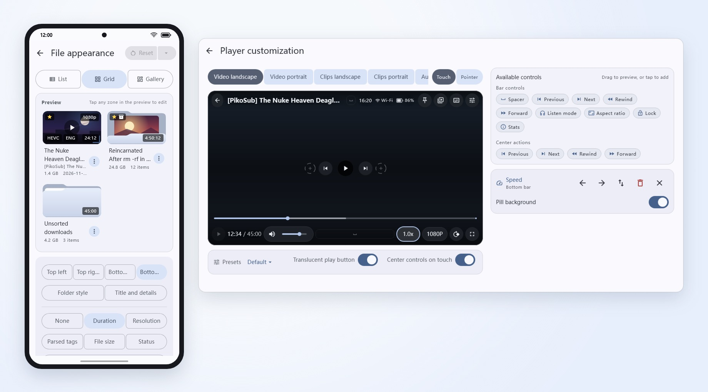

<a href="README.md">简体中文</a> | <a href="README.zh-Hant.md">繁體中文</a> | <a href="README.ko.md">한국어</a> | <a href="README.ja.md">日本語</a> | <b>English</b>

<picture>
<source media="(prefers-color-scheme: dark)" type="image/avif" srcset="https://raw.githubusercontent.com/NihilDigit/piko/main/docs/banner-dark.avif">
<source type="image/avif" srcset="https://raw.githubusercontent.com/NihilDigit/piko/main/docs/banner.avif">
<source media="(prefers-color-scheme: dark)" srcset="https://raw.githubusercontent.com/NihilDigit/piko/main/docs/banner-dark.jpg">

</picture>

<b>An elegant, easy-to-use, high-performance PikPak client</b> 
Available on Android, Windows, macOS, Linux, iOS, and iPadOS

Telegram Channel <a href="https://t.me/piko_dev">@piko_dev</a> | <a href="https://t.me/+mTkqVFyYnjszMjA1">Chat Group</a>

## Workspace

Built for large directories and multitasking with a consistent, responsive experience across desktop and mobile, supporting tabs, pinned folders, and local folder mounting.

<picture>
<source media="(prefers-color-scheme: dark)" srcset="https://raw.githubusercontent.com/NihilDigit/piko/main/docs/screenshots/hero-en-dark.jpg">

</picture>

## Browsing

Use Gallery and Feed to quickly browse and locate what you want across large collections of videos and images.

<picture>
<source media="(prefers-color-scheme: dark)" type="image/avif" srcset="https://raw.githubusercontent.com/NihilDigit/piko/main/docs/screenshots/feed-en-dark.avif">
<source type="image/avif" srcset="https://raw.githubusercontent.com/NihilDigit/piko/main/docs/screenshots/feed-en.avif">
<source media="(prefers-color-scheme: dark)" srcset="https://raw.githubusercontent.com/NihilDigit/piko/main/docs/screenshots/feed-en-dark.jpg">

</picture>

## Links and archives

Pre-parse magnet, torrent, and share links to preview and pick files before saving or save as zero-quota references; browse cloud archives without extracting.

<picture>
<source media="(prefers-color-scheme: dark)" srcset="https://raw.githubusercontent.com/NihilDigit/piko/main/docs/screenshots/links-en-dark.jpg">

</picture>

## File tools

Extract lossless video clips, batch rename, find duplicates across folders, and archive to reclaim quota, alongside instant drive-wide search and a space map powered by a local index.

<picture>
<source media="(prefers-color-scheme: dark)" srcset="https://raw.githubusercontent.com/NihilDigit/piko/main/docs/screenshots/tools-en-dark.jpg">

</picture>

## Customization

Customize file views and player layouts to match how you work.

<picture>
<source media="(prefers-color-scheme: dark)" srcset="https://raw.githubusercontent.com/NihilDigit/piko/main/docs/screenshots/customize-en-dark.jpg">

</picture>

## Transfers, accounts, and sync

Parallel connections route around slow nodes for smooth playback and downloads over high-latency or proxy networks, while snail mode caps background transfers without affecting playback.

Sign in with password or Google and switch accounts anytime. Settings, pinned tabs, and stars sync across devices through your drive, while archive passwords and scraper configs support an independent passphrase.

## Install

Download from [Releases](https://github.com/NihilDigit/piko/releases/latest). Piko is fully open source: every package is built publicly from source by GitHub Actions with [SLSA Build L3 provenance attestations](https://github.com/NihilDigit/piko/attestations) for an auditable build chain. Desktop and Android support in-app updates.

| Platform | Status | Requirements | Package and notes |
| --- | --- | --- | --- |
| **Android** | Stable | Android 8.0+ | Pick the APK for your architecture (`universal` if unsure) |
| **Windows** | Stable | Windows 10+ (x64), Windows 11+ (arm64) | `.msi` installer or `.7z` portable build (use [NanaZip](https://apps.microsoft.com/detail/9n8g7tscl18r) or 7-Zip on Windows 10) |
| **macOS** | Experimental | macOS 12+ (Apple silicon) | Allow once under System Settings → Privacy & Security |
| **Linux** | Experimental | x64, glibc 2.38+ (Ubuntu 24.04, Debian 13, Fedora 39+) | Make the AppImage executable and run |
| **iOS / iPadOS** | Experimental | iOS 15+ | Unsigned `.ipa` for sideloading via AltStore, SideStore, Sideloadly, or TrollStore |

## Contributing

- Issues and pull requests are welcome; small bug fixes, crash reports, and documentation fixes can go straight in as a PR.
- **Open an issue first for major new features or architectural changes** to align on the use case and approach before writing code.
- **If you use an LLM to help write code, make sure you understand every change and verify it on a real device**.
- Pull requests require signing the [Contributor License Agreement](CLA.md); see [CONTRIBUTING.md](CONTRIBUTING.md) for building from source and submission details.

## License and credits

- The source code is under the [AGPL-3.0-or-later](LICENSE) license. Version 1.1.0 and earlier were released under the MIT license. The Android packages bundle GPLv3 builds of mpv and FFmpeg.
- The PikPak API implementation draws on [52funny/pikpakcli](https://github.com/52funny/pikpakcli).
- Several features are modelled on the PikPak web enhancement script [digbug82/PikPak_Enhancement_Master](https://github.com/digbug82/PikPak_Enhancement_Master).
- Zero-copy mpv rendering on Windows is provided by [MediaMP](https://github.com/open-ani/mediamp).

## Star History

<a href="https://www.star-history.com/#nihildigit/piko&Date">
<picture>
<source media="(prefers-color-scheme: dark)" srcset="https://api.star-history.com/svg?repos=nihildigit/piko&type=Date&theme=dark&legend=bottom-right">

</picture>
</a>
