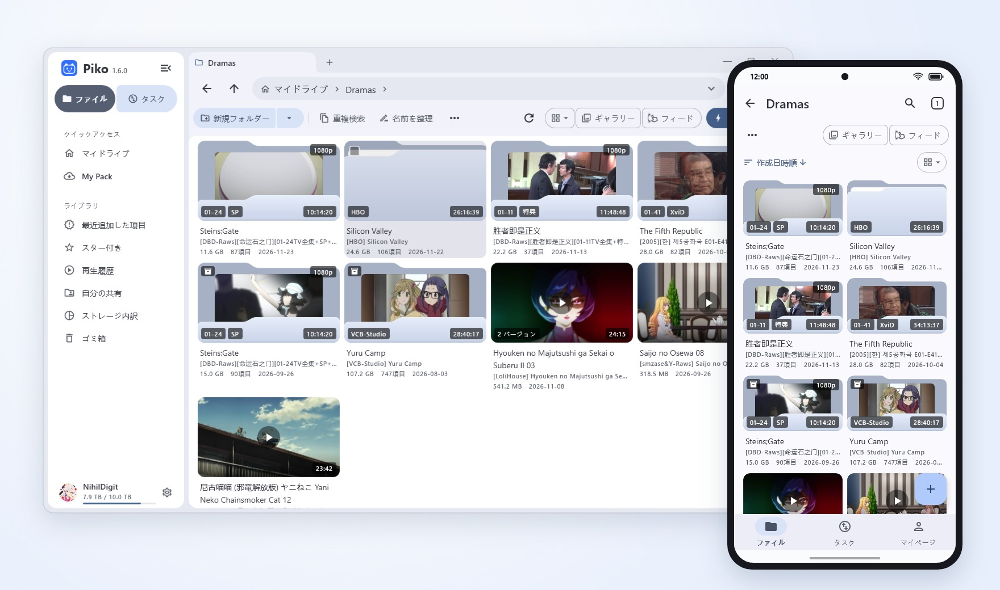
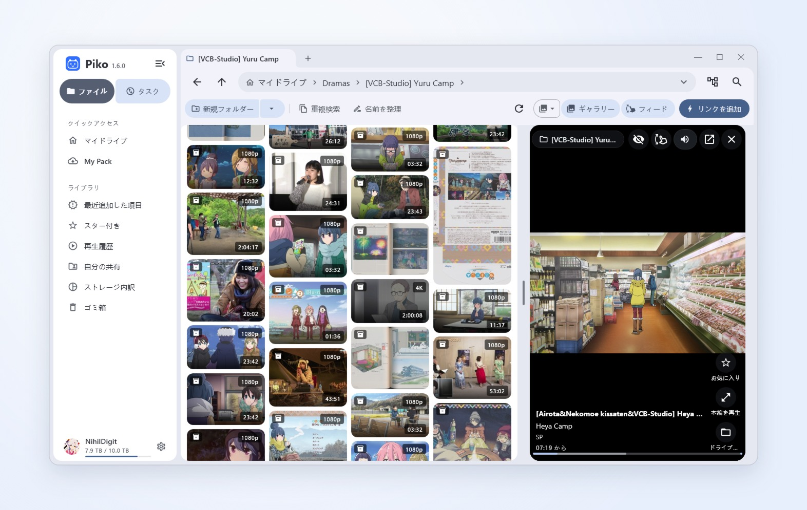
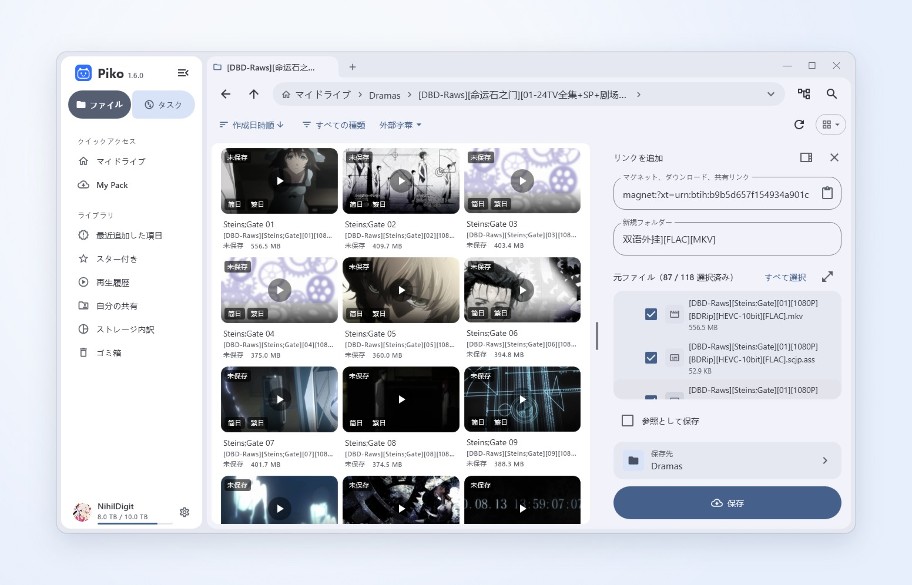
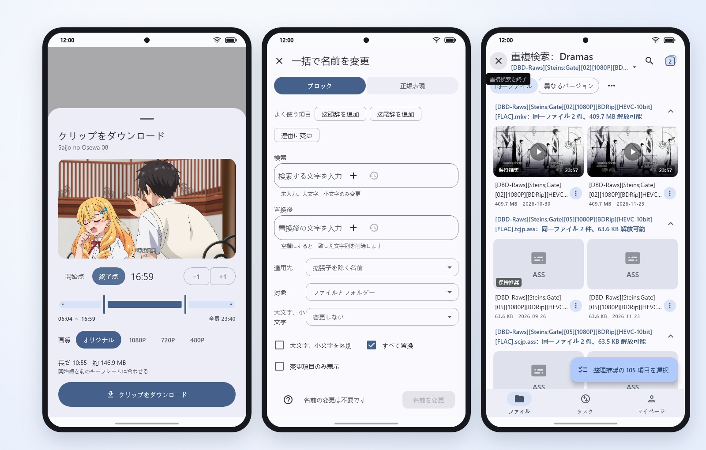
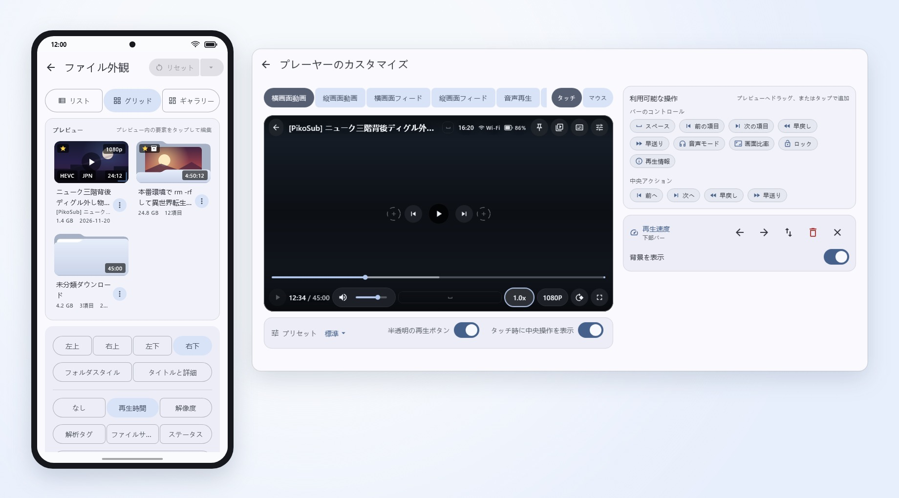

<a href="README.md">简体中文</a> | <a href="README.zh-Hant.md">繁體中文</a> | <a href="README.ko.md">한국어</a> | <b>日本語</b> | <a href="README.en.md">English</a>

<picture>
<source media="(prefers-color-scheme: dark)" type="image/avif" srcset="https://raw.githubusercontent.com/NihilDigit/piko/main/docs/banner-dark.avif">
<source type="image/avif" srcset="https://raw.githubusercontent.com/NihilDigit/piko/main/docs/banner.avif">
<source media="(prefers-color-scheme: dark)" srcset="https://raw.githubusercontent.com/NihilDigit/piko/main/docs/banner-dark.jpg">

</picture>

<b>洗練された、使いやすく高速な PikPak クライアント</b> 
Android、Windows、macOS、Linux、iOS、iPadOS に対応

Telegram 更新チャンネル <a href="https://t.me/piko_dev">@piko_dev</a> ｜ <a href="https://t.me/+mTkqVFyYnjszMjA1">チャットグループ</a>

## ワークスペース

大規模フォルダーの閲覧や並行作業向けに設計され、デスクトップとモバイルの双方で一貫した快適な操作感を提供します。マルチタブ、フォルダー固定、ローカルフォルダーのマウントに対応しています。

<picture>
<source media="(prefers-color-scheme: dark)" srcset="https://raw.githubusercontent.com/NihilDigit/piko/main/docs/screenshots/hero-ja-dark.jpg">

</picture>

## 閲覧モード

ギャラリーとフィードを活用して、大量の動画や画像の中から見たいコンテンツをすばやく見つけられます。

<picture>
<source media="(prefers-color-scheme: dark)" type="image/avif" srcset="https://raw.githubusercontent.com/NihilDigit/piko/main/docs/screenshots/feed-ja-dark.avif">
<source type="image/avif" srcset="https://raw.githubusercontent.com/NihilDigit/piko/main/docs/screenshots/feed-ja.avif">
<source media="(prefers-color-scheme: dark)" srcset="https://raw.githubusercontent.com/NihilDigit/piko/main/docs/screenshots/feed-ja-dark.jpg">

</picture>

## リンク解析とアーカイブ

マグネット、トレント、共有リンクを事前解析し、保存前の選択や容量消費なしの参照保存に対応します。クラウド上の圧縮ファイルも展開せずそのまま閲覧できます。

<picture>
<source media="(prefers-color-scheme: dark)" srcset="https://raw.githubusercontent.com/NihilDigit/piko/main/docs/screenshots/links-ja-dark.jpg">

</picture>

## ファイル処理

無劣化での動画クリップ切り出し、一括リネーム、フォルダー横断の重複検索、空き容量を確保するアーカイブを備え、ローカルインデックスによる即時の全体検索と容量マップに対応します。

<picture>
<source media="(prefers-color-scheme: dark)" srcset="https://raw.githubusercontent.com/NihilDigit/piko/main/docs/screenshots/tools-ja-dark.jpg">

</picture>

## カスタマイズ

使い慣れたスタイルに合わせて、ファイル表示とプレーヤー画面を自由に調整できます。

<picture>
<source media="(prefers-color-scheme: dark)" srcset="https://raw.githubusercontent.com/NihilDigit/piko/main/docs/screenshots/customize-ja-dark.jpg">

</picture>

## 転送、アカウントと同期

並列接続で遅いノードを回避し、高遅延やプロキシ経由でも快適な再生とダウンロードを実現します。低速モードは再生に影響しません。

パスワードと Google ログイン、複数アカウントの切り替えに対応。設定、ピン留めタブ、スターはドライブ経由で自動同期され、書庫パスワードとメタデータ設定は独立パスフレーズで暗号化できます。

## インストール

[Releases](https://github.com/NihilDigit/piko/releases/latest) からダウンロードしてください。ソースコードは完全オープンソースであり、すべてのパッケージは GitHub Actions 上でソースから公開ビルドされ、[SLSA Build L3 来歴証明](https://github.com/NihilDigit/piko/attestations)が付与されるためビルド過程を監査できます。デスクトップ版と Android 版はアプリ内更新に対応しています。

| プラットフォーム | 対応状況 | 動作環境 | パッケージと補足 |
| --- | --- | --- | --- |
| **Android** | 正式対応 | Android 8.0 以降 | アーキテクチャに合った APK（不明な場合は `universal`） |
| **Windows** | 正式対応 | x64 は Windows 10+、arm64 は Windows 11+ | `.msi` インストーラー版または `.7z` ポータブル版（Win10 では [NanaZip](https://apps.microsoft.com/detail/9n8g7tscl18r) または 7-Zip で展開） |
| **macOS** | 実験的 | macOS 12 以降（Apple シリコン） | 初回起動時は「システム設定 → プライバシーとセキュリティ」から許可 |
| **Linux** | 実験的 | x64、glibc 2.38 以降（Ubuntu 24.04、Debian 13、Fedora 39+） | AppImage に実行権限を付与して起動 |
| **iOS / iPadOS** | 実験的 | iOS 15 以降 | 未署名 `.ipa` を AltStore、SideStore、Sideloadly、TrollStore 等でサイドロード |

## コントリビューション

- Issue や PR を歓迎します（軽微なバグ修正、クラッシュ調査、ドキュメント補足はそのまま PR を送ってください）。
- **大規模な機能追加やアーキテクチャ変更は、実装前に必ず Issue を立てて**利用場面と方針を共有してください。
- **LLM を補助としてコードを書く場合は、追加されるロジックを十分に理解し、必ず実機で検証してください**。
- PR の提出には[コントリビューターライセンス契約](CLA.md)への署名が必要です。ソースからのビルドと提出手順は [CONTRIBUTING.md](CONTRIBUTING.md) を参照してください。

## ライセンスと謝辞

- ソースコードは [AGPL-3.0-or-later](LICENSE) ライセンスのもとで公開されています。Android パッケージには GPLv3 でビルドされた mpv と FFmpeg が同梱されています。
- PikPak の API 仕様および一部の設計アイデアは、[52funny/pikpakcli](https://github.com/52funny/pikpakcli)、[digbug82/PikPak_Enhancement_Master](https://github.com/digbug82/PikPak_Enhancement_Master)、[tonyflux/pkp](https://github.com/tonyflux/pkp) といった優れたコミュニティのオープンソースプロジェクトを参考にしました。
- [open-ani](https://github.com/open-ani) コミュニティの [Animeko](https://github.com/open-ani/animeko) と [MediaMP](https://github.com/open-ani/mediamp) に感謝します。Piko のデスクトップ再生は MediaMP を基盤としており、KMP メディアアプリおよびオープンソース開発のノウハウも Animeko コミュニティでの協業経験に負うところが大きいです。

## Star History

<a href="https://www.star-history.com/#nihildigit/piko&Date">
<picture>
<source media="(prefers-color-scheme: dark)" srcset="https://api.star-history.com/svg?repos=nihildigit/piko&type=Date&theme=dark&legend=bottom-right">

</picture>
</a>
