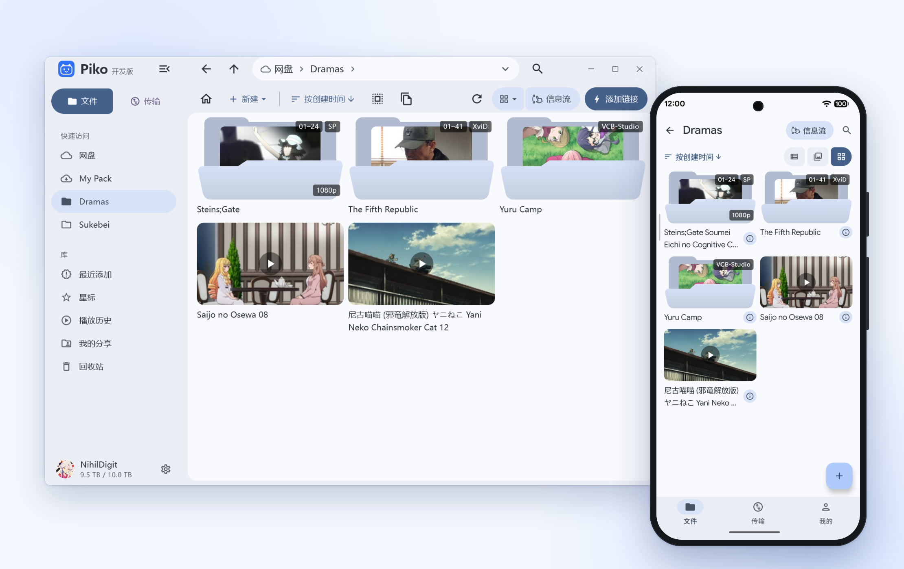
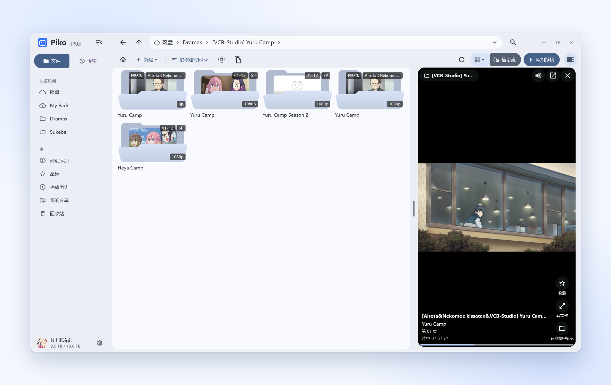
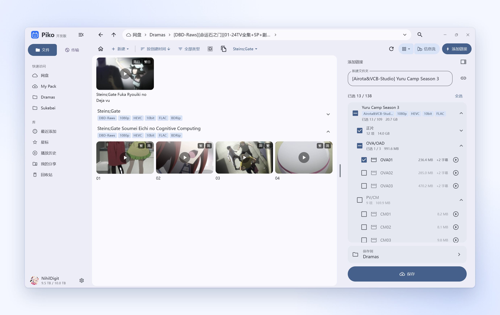
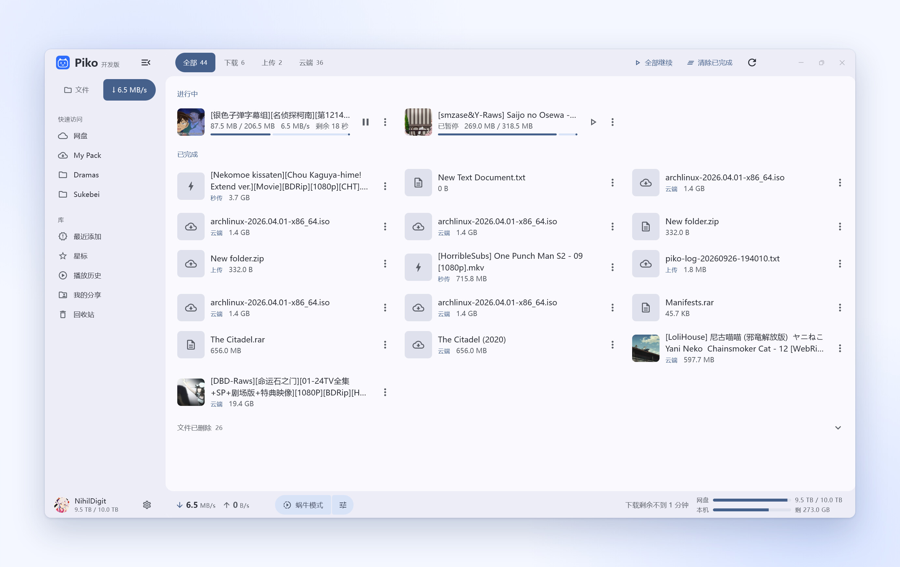
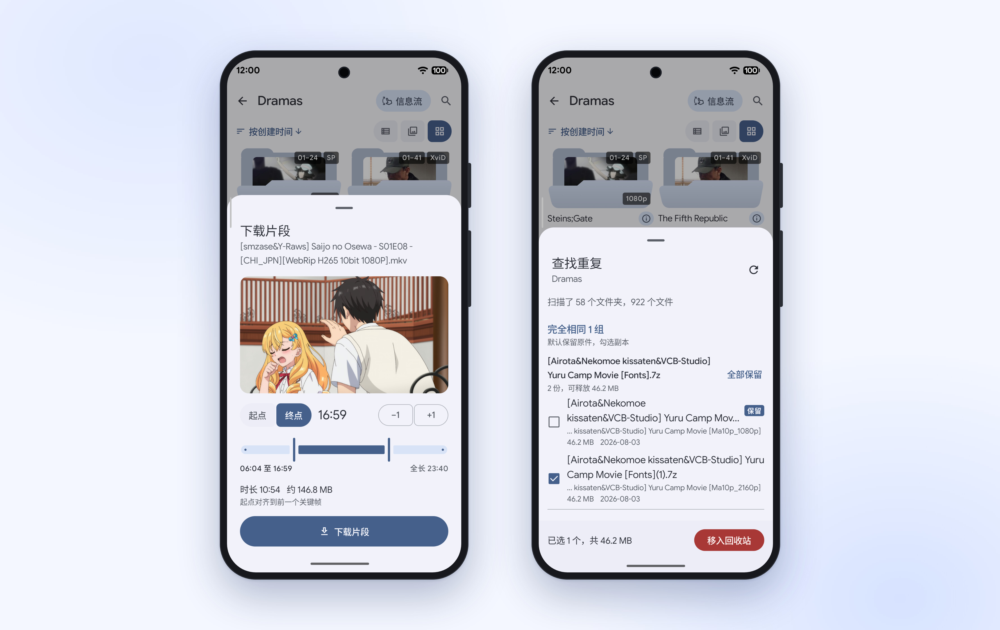

<a href="README.md">简体中文</a> | <a href="README.zh-Hant.md">繁體中文</a> | <a href="README.ko.md">한국어</a> | <b>日本語</b> | <a href="README.en.md">English</a>

<h1 align="center">Piko</h1>

<b>高速なクロスプラットフォームの PikPak クライアント</b> 
Android、Windows、macOS、Linux、iOS、iPadOS に対応

Telegram 更新チャンネル <a href="https://t.me/piko_dev">@piko_dev</a> ｜ <a href="https://t.me/+mTkqVFyYnjszMjA1">チャットグループ</a>

## アダプティブレイアウト

デスクトップではマウスとキーボードに最適化し、モバイルでは簡潔に扱えます。マルチタブとフォルダー固定、ギャラリーでの動画と画像の閲覧、ローカルフォルダーの読み取り専用マウントに対応しています。

<picture>
<source media="(prefers-color-scheme: dark)" srcset="https://raw.githubusercontent.com/NihilDigit/piko/main/docs/screenshots/hero-dark.jpg">

</picture>

## クリップフィード

現在のフォルダーや選択した動画からランダムにクリップを再生し、上下スワイプで切り替えます。自動延長と自動送りに対応しています。

<picture>
<source media="(prefers-color-scheme: dark)" type="image/avif" srcset="https://raw.githubusercontent.com/NihilDigit/piko/main/docs/screenshots/feed-dark.avif">
<source type="image/avif" srcset="https://raw.githubusercontent.com/NihilDigit/piko/main/docs/screenshots/feed.avif">
<source media="(prefers-color-scheme: dark)" srcset="https://raw.githubusercontent.com/NihilDigit/piko/main/docs/screenshots/feed-dark.jpg">

</picture>

## リンクとアーカイブ

マグネット、トレント、ed2k、thunder、直リンク、共有リンクを解析し、保存前に選択するか容量消費なしの参照として保存できます。クラウド上の圧縮ファイルは展開せずそのまま閲覧でき、エピソードの自動整理とサンプル類の折りたたみに対応しています。

<picture>
<source media="(prefers-color-scheme: dark)" srcset="https://raw.githubusercontent.com/NihilDigit/piko/main/docs/screenshots/links-dark.jpg">

</picture>

## 再生と転送

並列接続で遅いノードを自動回避し、高遅延やプロキシ経由でも快適な再生とダウンロードを実現します。ハードウェアデコード内蔵プレーヤーと外部プレーヤー連携を備え、低速モードは再生に影響しません。

<picture>
<source media="(prefers-color-scheme: dark)" srcset="https://raw.githubusercontent.com/NihilDigit/piko/main/docs/screenshots/transfers-dark.jpg">

</picture>

## ファイル処理

ローカルツリーによる即時の全体検索と容量マップに対応し、空き容量を確保するアーカイブ、無劣化での動画切り出し、メタデータ取得による一括リネーム、フォルダー横断の重複検出を備えています。

<picture>
<source media="(prefers-color-scheme: dark)" srcset="https://raw.githubusercontent.com/NihilDigit/piko/main/docs/screenshots/tools-dark.jpg">

</picture>

## アカウントと同期

パスワードと Google ログイン、複数アカウントの切り替えに対応。設定、ピン留めタブ、スターはドライブ経由で自動同期され、書庫パスワードとメタデータ設定は独立パスフレーズで暗号化できます。

## インストール

[Releases](https://github.com/NihilDigit/piko/releases/latest) からダウンロードしてください。すべて GitHub Actions でソースからビルドされ、デスクトップ版と Android 版はアプリ内更新に対応しています。

- **Android**：Android 8.0 以降。アーキテクチャに合った APK（不明な場合は `universal`）を選択してください。
- **Windows**：x64 は Windows 10 以降、arm64 は Windows 11 以降。`.msi` はインストーラー版、`.7z` はポータブル版です（Windows 10 では [NanaZip](https://apps.microsoft.com/detail/9n8g7tscl18r) または 7-Zip で展開）。
- **macOS**（実験的）：macOS 12 以降（Apple シリコン）。初回起動時は「システム設定 → プライバシーとセキュリティ」から許可してください。
- **Linux**（実験的）：x64、glibc 2.38 以降（Ubuntu 24.04、Debian 13、Fedora 39 以降）。AppImage に実行権限を付与して起動してください。
- **iOS / iPadOS**（実験的）：iOS 15 以降。未署名 `.ipa` を AltStore、SideStore、Sideloadly、TrollStore 等でサイドロードしてください。

## コントリビューション

ロードマップは [#10](https://github.com/NihilDigit/piko/issues/10) にあります。

Issue や PR を歓迎します。軽微なバグ修正、クラッシュ調査、ドキュメントの補足はそのまま PR を送ってください。

新機能の追加やアーキテクチャの変更を予定している場合は、先に Issue を立てて利用場面と方針を共有し、方向性を確認してから実装に入ってください。

LLM を補助としてコードを書く場合は、追加されるロジックを理解したうえで実機で検証してください。

PR の提出には[コントリビューターライセンス契約](CLA.md)への署名が必要です。手順は [CONTRIBUTING.md](CONTRIBUTING.md) を参照してください。

## ライセンスと謝辞

- ソースコードは [AGPL-3.0-or-later](LICENSE) ライセンスのもとで公開されています。1.1.0 以前のバージョンは MIT ライセンスで配布されました。
  Android パッケージには GPLv3 でビルドされた mpv と FFmpeg が同梱されています。
- PikPak API の実装は [52funny/pikpakcli](https://github.com/52funny/pikpakcli) を参考にしました。
- いくつかの機能設計は PikPak Web 拡張スクリプト [digbug82/PikPak_Enhancement_Master](https://github.com/digbug82/PikPak_Enhancement_Master) を参考にしました。
- Windows 版における mpv のゼロコピー描画は [MediaMP](https://github.com/open-ani/mediamp) により実現されています。

## Star History

<a href="https://www.star-history.com/#nihildigit/piko&Date">
<picture>
<source media="(prefers-color-scheme: dark)" srcset="https://api.star-history.com/svg?repos=nihildigit/piko&type=Date&theme=dark&legend=bottom-right">

</picture>
</a>
