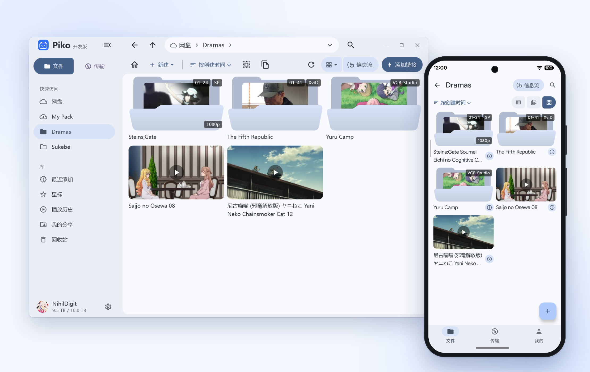
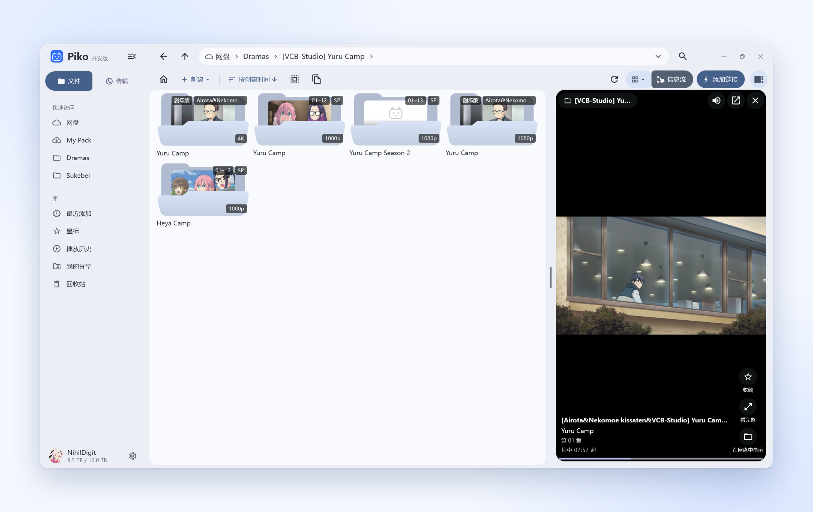
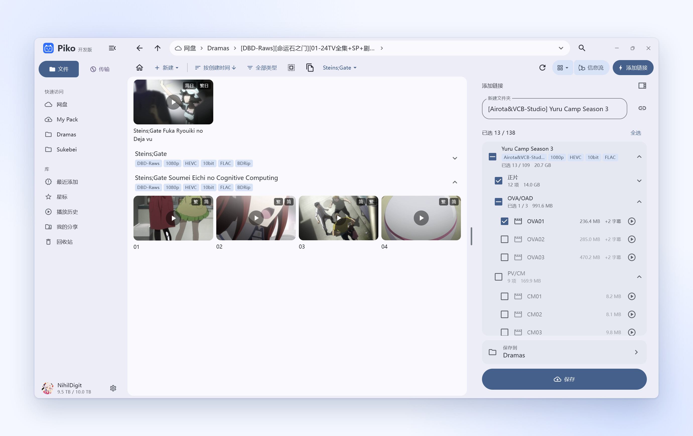
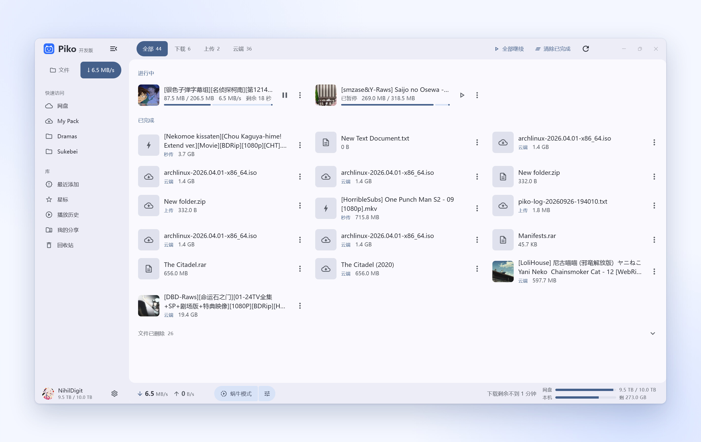
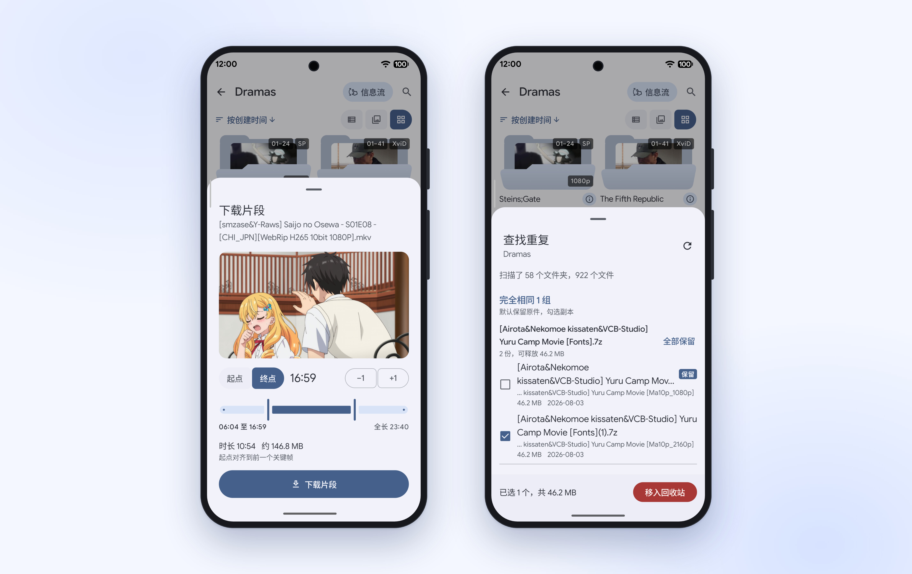

<a href="README.md">简体中文</a> | <a href="README.zh-Hant.md">繁體中文</a> | <b>한국어</b> | <a href="README.ja.md">日本語</a> | <a href="README.en.md">English</a>

<h1 align="center">Piko</h1>

<b>빠르고 가벼운 크로스 플랫폼 PikPak 클라이언트</b> 
Android, Windows, macOS, Linux, iOS 및 iPadOS 지원

Telegram 소식 채널 <a href="https://t.me/piko_dev">@piko_dev</a> ｜ <a href="https://t.me/+mTkqVFyYnjszMjA1">채팅방</a>

## 적응형 레이아웃

데스크톱에서는 키보드와 마우스 조작에 맞춰지고 모바일에서는 간결하게 동작합니다. 다중 탭과 폴더 고정, 갤러리 동영상 및 이미지 탐색, 로컬 폴더 읽기 전용 마운트를 지원합니다.

<picture>
<source media="(prefers-color-scheme: dark)" srcset="https://raw.githubusercontent.com/NihilDigit/piko/main/docs/screenshots/hero-dark.jpg">

</picture>

## 클립 피드

현재 폴더나 선택한 동영상의 구간을 무작위로 재생하며 위아래로 넘겨 전환합니다. 자동 연장 재생과 자동 다음 재생을 지원합니다.

<picture>
<source media="(prefers-color-scheme: dark)" type="image/avif" srcset="https://raw.githubusercontent.com/NihilDigit/piko/main/docs/screenshots/feed-dark.avif">
<source type="image/avif" srcset="https://raw.githubusercontent.com/NihilDigit/piko/main/docs/screenshots/feed.avif">
<source media="(prefers-color-scheme: dark)" srcset="https://raw.githubusercontent.com/NihilDigit/piko/main/docs/screenshots/feed-dark.jpg">

</picture>

## 링크 및 압축 파일

마그넷, 토렌트, ed2k, thunder, 직접 다운로드 및 공유 링크를 분석하며, 저장 전 미리 선택하거나 용량을 차지하지 않는 참조로 저장할 수 있습니다. 클라우드 압축 파일은 압축 해제 없이 바로 탐색하며, 회차별 자동 정리와 샘플 영상 접기를 지원합니다.

<picture>
<source media="(prefers-color-scheme: dark)" srcset="https://raw.githubusercontent.com/NihilDigit/piko/main/docs/screenshots/links-dark.jpg">

</picture>

## 재생 및 전송

다중 연결로 느린 노드를 자동 우회하여 고지연 및 프록시 회선에서도 원활한 재생과 다운로드를 제공합니다. 내장 하드웨어 디코딩 플레이어와 외부 플레이어 연동을 지원하며, 저속 모드는 재생에 영향을 주지 않습니다.

<picture>
<source media="(prefers-color-scheme: dark)" srcset="https://raw.githubusercontent.com/NihilDigit/piko/main/docs/screenshots/transfers-dark.jpg">

</picture>

## 파일 처리

로컬 폴더 트리 기반의 즉각적인 전체 검색과 용량 분포도를 지원하며, 공간 확보용 보관, 무손실 구간 추출, 메타데이터 기반 일괄 이름 변경 및 폴더 간 중복 파일 찾기를 제공합니다.

<picture>
<source media="(prefers-color-scheme: dark)" srcset="https://raw.githubusercontent.com/NihilDigit/piko/main/docs/screenshots/tools-dark.jpg">

</picture>

## 계정 및 동기화

비밀번호 및 Google 로그인과 다중 계정 전환을 지원합니다. 설정, 고정 탭, 별표는 드라이브를 통해 기기 간 자동 동기화되며, 압축 비밀번호와 메타데이터 설정은 독립 암호문으로 암호화할 수 있습니다.

## 설치

[Releases](https://github.com/NihilDigit/piko/releases/latest)에서 다운로드합니다. 모든 패키지는 GitHub Actions에서 소스로부터 빌드되며, 데스크톱과 Android는 앱 내 업데이트를 지원합니다.

- **Android**: Android 8.0 이상, 아키텍처에 맞는 APK 선택(불확실하면 `universal`).
- **Windows**: x64는 Windows 10+, arm64는 Windows 11+. `.msi` 설치판 또는 `.7z` 포터블(Windows 10에서는 [NanaZip](https://apps.microsoft.com/detail/9n8g7tscl18r) 또는 7-Zip 사용).
- **macOS** (실험적 지원): macOS 12+ (Apple Silicon), 첫 실행 시 「시스템 설정 → 개인정보 보호 및 보안」에서 허용.
- **Linux** (실험적 지원): x64, glibc 2.38+ (Ubuntu 24.04, Debian 13, Fedora 39+), AppImage에 실행 권한 부여 후 실행.
- **iOS / iPadOS** (실험적 지원): iOS 15+, 미서명 `.ipa`, AltStore, SideStore, Sideloadly 또는 TrollStore로 사이드로드.

## 기여 안내

로드맵은 [#10](https://github.com/NihilDigit/piko/issues/10)에서 확인할 수 있습니다.

이슈 제보와 PR을 환영합니다. 작은 버그 수정, 비정상 종료 분석 및 문서 보완은 바로 PR로 제출할 수 있습니다.

새로운 기능을 추가하거나 아키텍처를 변경하려는 경우, 먼저 이슈를 열어 사용 시나리오와 설계 방향을 논의한 뒤 구현을 진행해 주세요.

LLM의 도움을 받아 코드를 작성할 때는 추가되는 로직을 충분히 이해하고 실제 기기에서 검증해 주세요.

PR을 제출하기 전에 [기여자 라이선스 계약](CLA.md)에 서명해야 합니다. 자세한 방법은 [CONTRIBUTING.md](CONTRIBUTING.md)를 참고하세요.

## 라이선스 및 감사의 글

- 소스 코드는 [AGPL-3.0-or-later](LICENSE) 라이선스로 공개됩니다. 1.1.0 이하 버전은 MIT 라이선스로 배포되었습니다.
  Android 패키지에는 GPLv3로 빌드된 mpv와 FFmpeg가 포함되어 있습니다.
- PikPak API 구현은 [52funny/pikpakcli](https://github.com/52funny/pikpakcli)를 참고했습니다.
- 여러 기능 설계는 PikPak 웹 확장 스크립트 [digbug82/PikPak_Enhancement_Master](https://github.com/digbug82/PikPak_Enhancement_Master)를 참고했습니다.
- Windows용 mpv 제로카피 렌더링은 [MediaMP](https://github.com/open-ani/mediamp)로 구현되었습니다.

## Star History

<a href="https://www.star-history.com/#nihildigit/piko&Date">
<picture>
<source media="(prefers-color-scheme: dark)" srcset="https://api.star-history.com/svg?repos=nihildigit/piko&type=Date&theme=dark&legend=bottom-right">

</picture>
</a>
