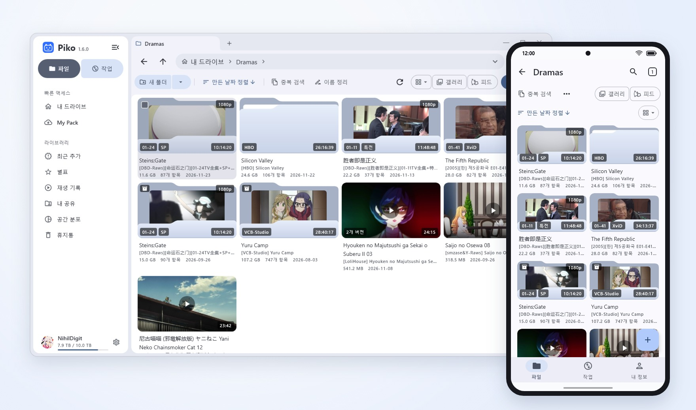
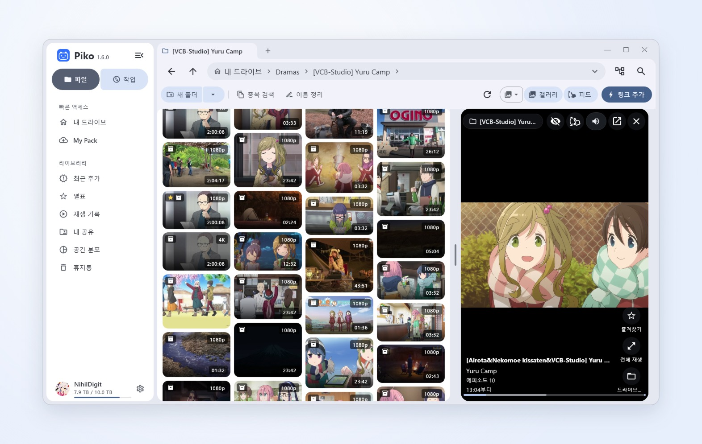
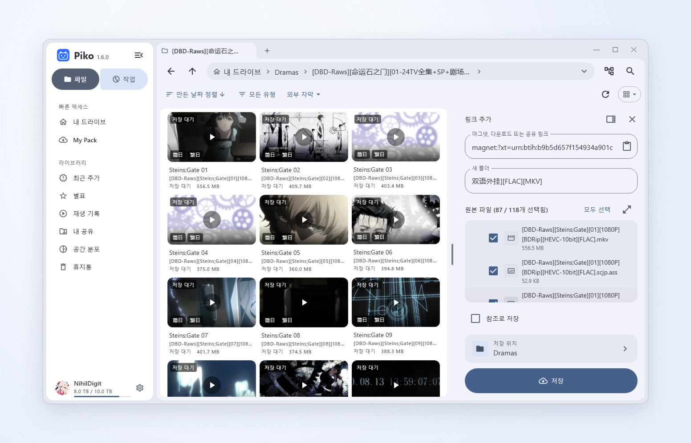
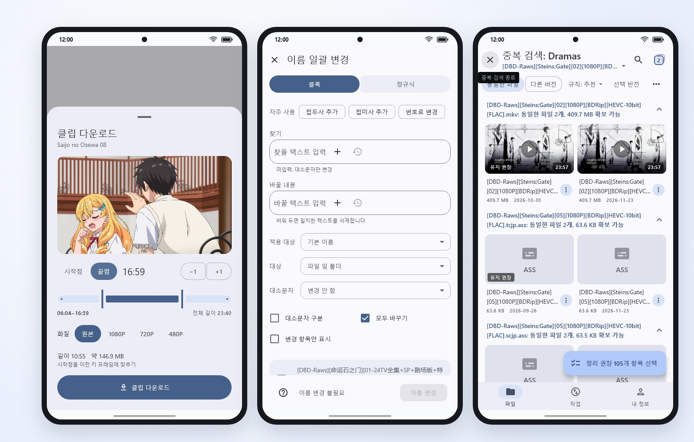
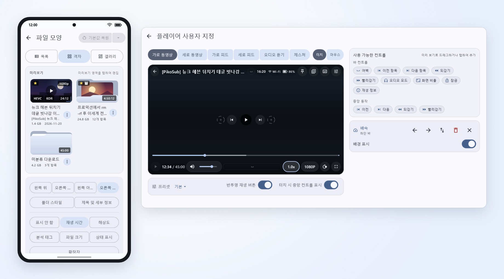

<a href="README.md">简体中文</a> | <a href="README.zh-Hant.md">繁體中文</a> | <b>한국어</b> | <a href="README.ja.md">日本語</a> | <a href="README.en.md">English</a>

<picture>
<source media="(prefers-color-scheme: dark)" type="image/avif" srcset="https://raw.githubusercontent.com/NihilDigit/piko/main/docs/banner-dark.avif">
<source type="image/avif" srcset="https://raw.githubusercontent.com/NihilDigit/piko/main/docs/banner.avif">
<source media="(prefers-color-scheme: dark)" srcset="https://raw.githubusercontent.com/NihilDigit/piko/main/docs/banner-dark.jpg">

</picture>

<b>세련되고 사용하기 쉬우며 고성능인 PikPak 클라이언트</b> 
Android, Windows, macOS, Linux, iOS 및 iPadOS 지원

Telegram 소식 채널 <a href="https://t.me/piko_dev">@piko_dev</a> ｜ <a href="https://t.me/+mTkqVFyYnjszMjA1">채팅방</a>

## 워크스페이스

대규모 폴더 탐색과 멀티태스킹을 위해 설계되었으며 데스크톱과 모바일 모두에서 일관된 쾌적함을 제공합니다. 다중 탭, 폴더 고정, 로컬 폴더 마운트를 지원합니다.

<picture>
<source media="(prefers-color-scheme: dark)" srcset="https://raw.githubusercontent.com/NihilDigit/piko/main/docs/screenshots/hero-ko-dark.jpg">

</picture>

## 탐색 방식

갤러리와 피드를 활용해 수많은 동영상과 이미지 속에서 원하는 콘텐츠를 빠르게 찾을 수 있습니다.

<picture>
<source media="(prefers-color-scheme: dark)" type="image/avif" srcset="https://raw.githubusercontent.com/NihilDigit/piko/main/docs/screenshots/feed-ko-dark.avif">
<source type="image/avif" srcset="https://raw.githubusercontent.com/NihilDigit/piko/main/docs/screenshots/feed-ko.avif">
<source media="(prefers-color-scheme: dark)" srcset="https://raw.githubusercontent.com/NihilDigit/piko/main/docs/screenshots/feed-ko-dark.jpg">

</picture>

## 링크 분석 및 압축 파일

마그넷, 토렌트 및 공유 링크를 사전 분석해 저장 전 선택하거나 용량 소모 없이 참조로 저장할 수 있으며, 클라우드 압축 파일도 해제 없이 바로 탐색합니다.

<picture>
<source media="(prefers-color-scheme: dark)" srcset="https://raw.githubusercontent.com/NihilDigit/piko/main/docs/screenshots/links-ko-dark.jpg">

</picture>

## 파일 처리

무손실 동영상 구간 추출, 일괄 이름 변경, 폴더 간 중복 검색 및 공간 확보용 보관을 지원하며, 로컬 인덱스 기반의 즉각적인 전체 검색과 용량 분포도를 제공합니다.

<picture>
<source media="(prefers-color-scheme: dark)" srcset="https://raw.githubusercontent.com/NihilDigit/piko/main/docs/screenshots/tools-ko-dark.jpg">

</picture>

## 사용자 지정

사용 습관에 맞춰 파일 보기와 플레이어 화면을 자유롭게 조정할 수 있습니다.

<picture>
<source media="(prefers-color-scheme: dark)" srcset="https://raw.githubusercontent.com/NihilDigit/piko/main/docs/screenshots/customize-ko-dark.jpg">

</picture>

## 전송, 계정 및 동기화

다중 연결로 느린 노드를 우회하여 고지연 및 프록시 회선에서도 원활한 재생과 다운로드를 제공합니다. 저속 모드는 재생에 영향을 주지 않습니다.

비밀번호 및 Google 로그인과 다중 계정 전환을 지원합니다. 설정, 고정 탭, 별표는 드라이브를 통해 기기 간 자동 동기화되며, 압축 비밀번호와 메타데이터 설정은 독립 암호문으로 암호화할 수 있습니다.

## 설치

[Releases](https://github.com/NihilDigit/piko/releases/latest)에서 다운로드합니다. 소스 코드는 완전히 공개되어 있으며, 모든 패키지는 GitHub Actions에서 소스로부터 공개 빌드되고 [SLSA Build L3 출처 증명](https://github.com/NihilDigit/piko/attestations)이 첨부되어 빌드 전 과정을 감사할 수 있습니다. 데스크톱과 Android는 앱 내 업데이트를 지원합니다.

| 플랫폼 | 지원 상태 | 시스템 요구 사항 | 패키지 및 안내 |
| --- | --- | --- | --- |
| **Android** | 정식 지원 | Android 8.0 이상 | 아키텍처에 맞는 APK 선택(불확실하면 `universal`) |
| **Windows** | 정식 지원 | x64는 Windows 10+, arm64는 Windows 11+ | `.msi` 설치판 또는 `.7z` 포터블(Win10에서는 [NanaZip](https://apps.microsoft.com/detail/9n8g7tscl18r) 또는 7-Zip 사용) |
| **macOS** | 실험적 | macOS 12+ (Apple Silicon) | 첫 실행 시 「시스템 설정 → 개인정보 보호 및 보안」에서 허용 |
| **Linux** | 실험적 | x64, glibc 2.38+ (Ubuntu 24.04, Debian 13, Fedora 39+) | AppImage에 실행 권한 부여 후 실행 |
| **iOS / iPadOS** | 실험적 | iOS 15+ | 미서명 `.ipa`, AltStore, SideStore, Sideloadly 또는 TrollStore로 사이드로드 |

## 기여 안내

- 이슈 제보와 PR을 환영하며, 작은 버그 수정, 비정상 종료 분석 및 문서 보완은 바로 PR로 제출할 수 있습니다.
- **큰 기능 추가나 아키텍처 변경 전에는 반드시 이슈를 먼저 열어** 사용 시나리오와 설계 방향을 논의해 주세요.
- **LLM의 도움을 받아 코드를 작성할 때는 추가되는 로직을 충분히 이해하고 반드시 실제 기기에서 검증해야 합니다**.
- PR을 제출하기 전에 [기여자 라이선스 계약](CLA.md)에 서명해야 하며, 소스 빌드 및 제출 절차는 [CONTRIBUTING.md](CONTRIBUTING.md)를 참고하세요.

## 라이선스 및 감사의 글

- 소스 코드는 [AGPL-3.0-or-later](LICENSE) 라이선스로 공개됩니다. Android 패키지에는 GPLv3로 빌드된 mpv와 FFmpeg가 포함되어 있습니다.
- PikPak API 세부 사항과 일부 설계 아이디어는 [52funny/pikpakcli](https://github.com/52funny/pikpakcli), [digbug82/PikPak_Enhancement_Master](https://github.com/digbug82/PikPak_Enhancement_Master), [tonyflux/pkp](https://github.com/tonyflux/pkp) 등 훌륭한 커뮤니티 오픈소스 프로젝트를 참고했습니다.
- [open-ani](https://github.com/open-ani) 커뮤니티의 [Animeko](https://github.com/open-ani/animeko)와 [MediaMP](https://github.com/open-ani/mediamp)에 감사드립니다. Piko의 데스크톱 재생은 MediaMP를 기반으로 하며, KMP 미디어 앱과 오픈소스 엔지니어링 실무 역시 Animeko 커뮤니티에서의 협업 경험에서 큰 도움을 받았습니다.

## Star History

<a href="https://www.star-history.com/#nihildigit/piko&Date">
<picture>
<source media="(prefers-color-scheme: dark)" srcset="https://api.star-history.com/svg?repos=nihildigit/piko&type=Date&theme=dark&legend=bottom-right">

</picture>
</a>
