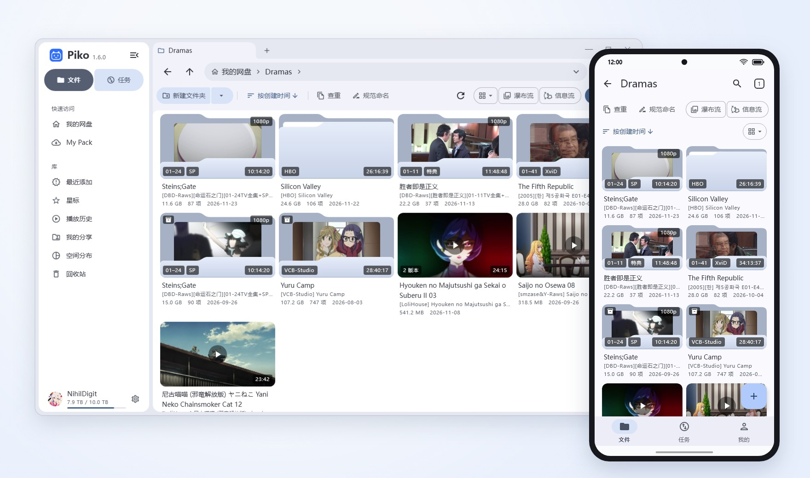
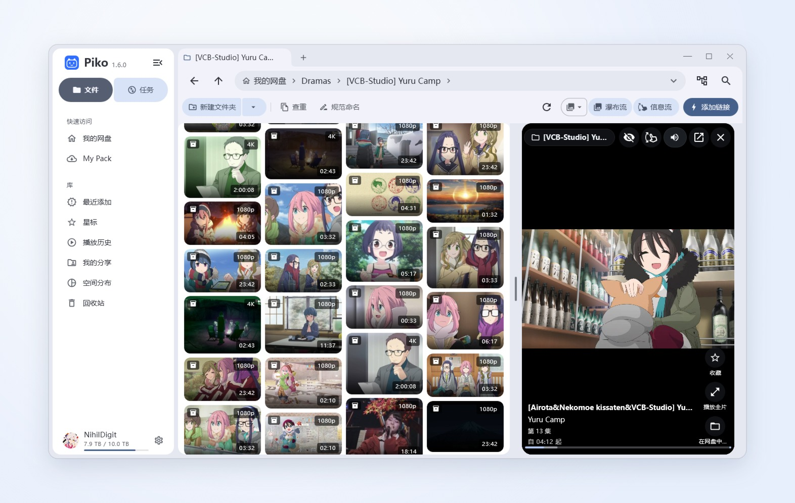
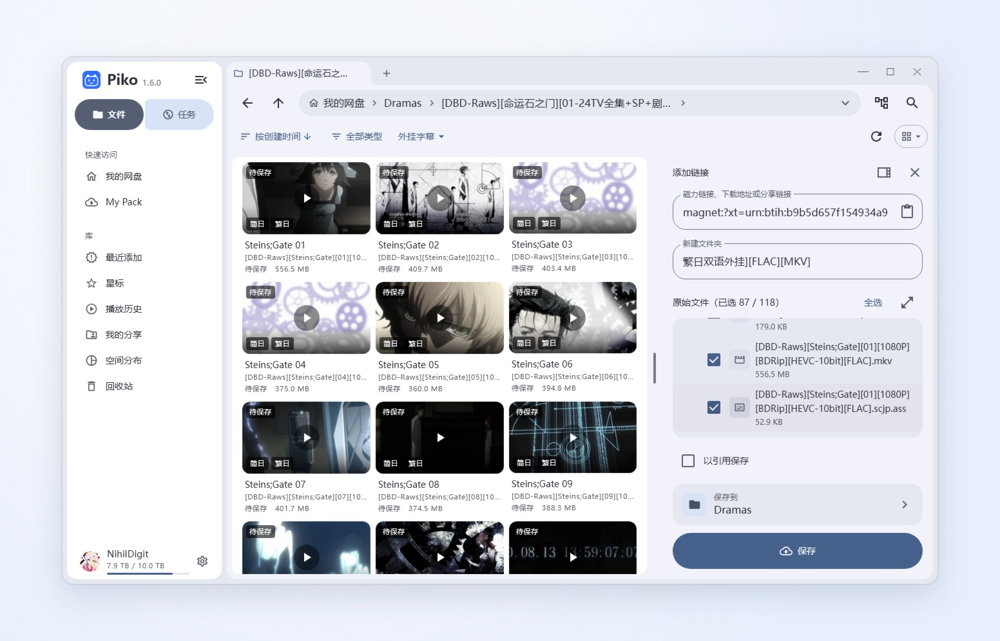
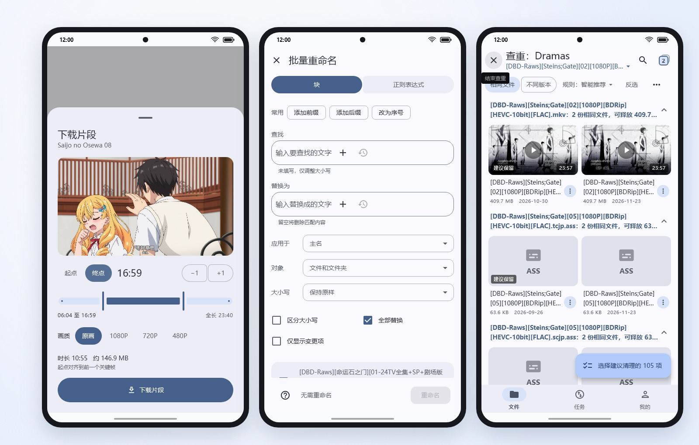
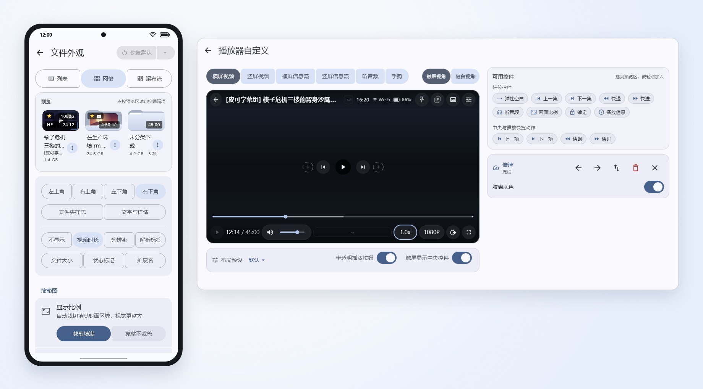

<b>简体中文</b> | <a href="README.zh-Hant.md">繁體中文</a> | <a href="README.ko.md">한국어</a> | <a href="README.ja.md">日本語</a> | <a href="README.en.md">English</a>

<picture>
<source media="(prefers-color-scheme: dark)" type="image/avif" srcset="https://raw.githubusercontent.com/NihilDigit/piko/main/docs/banner-dark.avif">
<source type="image/avif" srcset="https://raw.githubusercontent.com/NihilDigit/piko/main/docs/banner.avif">
<source media="(prefers-color-scheme: dark)" srcset="https://raw.githubusercontent.com/NihilDigit/piko/main/docs/banner-dark.jpg">

</picture>

<b>优雅、易用、高性能的 PikPak 客户端</b> 
支持 Android、Windows、macOS、Linux、iOS 与 iPadOS

Telegram 更新频道 <a href="https://t.me/piko_dev">@piko_dev</a> ｜ <a href="https://t.me/+mTkqVFyYnjszMjA1">交流群</a>

## 工作区

面向大目录浏览与多任务整理，在桌面端与移动端均保持一致的流畅体验，支持多标签、固定目录与本地文件夹挂载。

<picture>
<source media="(prefers-color-scheme: dark)" srcset="https://raw.githubusercontent.com/NihilDigit/piko/main/docs/screenshots/hero-dark.jpg">

</picture>

## 浏览方式

利用瀑布流和信息流，在海量视频与图片中快速定位感兴趣的内容。

<picture>
<source media="(prefers-color-scheme: dark)" type="image/avif" srcset="https://raw.githubusercontent.com/NihilDigit/piko/main/docs/screenshots/feed-dark.avif">
<source type="image/avif" srcset="https://raw.githubusercontent.com/NihilDigit/piko/main/docs/screenshots/feed.avif">
<source media="(prefers-color-scheme: dark)" srcset="https://raw.githubusercontent.com/NihilDigit/piko/main/docs/screenshots/feed-dark.jpg">

</picture>

## 链接解析与压缩包

预解析磁力、种子与分享链接，保存前预览挑选或免空间引用；云端压缩包免解压直接浏览。

<picture>
<source media="(prefers-color-scheme: dark)" srcset="https://raw.githubusercontent.com/NihilDigit/piko/main/docs/screenshots/links-dark.jpg">

</picture>

## 文件处理

支持无损截取视频片段、批量规范重命名、跨目录查重与归档释放空间，并基于本地索引提供全盘秒搜与空间分布图。

<picture>
<source media="(prefers-color-scheme: dark)" srcset="https://raw.githubusercontent.com/NihilDigit/piko/main/docs/screenshots/tools-dark.jpg">

</picture>

## 自定义

按照你的使用习惯，自由调整文件视图与播放器界面。

<picture>
<source media="(prefers-color-scheme: dark)" srcset="https://raw.githubusercontent.com/NihilDigit/piko/main/docs/screenshots/customize-dark.jpg">

</picture>

## 传输、账号与同步

多连接并发绕开慢节点，优化高延迟与代理线路下的播放和下载；蜗牛模式独立限速，不影响播放。

支持密码与 Google 登录及多账号切换。设置、固定标签与星标通过网盘跨设备同步，压缩包密码与刮削配置支持独立口令加密。

## 安装

前往 [Releases](https://github.com/NihilDigit/piko/releases/latest) 下载。项目源码完全开源，所有安装包均由 GitHub Actions 从源码公开构建，附带 [SLSA Build L3 来源证明](https://github.com/NihilDigit/piko/attestations)，构建过程全程可审计；桌面端与 Android 端均支持应用内更新。

| 平台 | 支持状态 | 系统要求 | 安装包与说明 |
| --- | --- | --- | --- |
| **Android** | 正式支持 | Android 8.0+ | 按架构选择 APK，不确定时选 `universal` |
| **Windows** | 正式支持 | x64 需 Windows 10+，arm64 需 Windows 11+ | `.msi` 安装版或 `.7z` 便携版（Win10 可用 [NanaZip](https://apps.microsoft.com/detail/9n8g7tscl18r) 或 7-Zip 解压） |
| **macOS** | 实验性 | macOS 12+（Apple 芯片） | 首次打开需在「系统设置 → 隐私与安全性」中放行 |
| **Linux** | 实验性 | x64，glibc 2.38+（Ubuntu 24.04、Debian 13、Fedora 39+） | AppImage 添加执行权限后直接运行 |
| **iOS / iPadOS** | 实验性 | iOS 15+ | 未签名 `.ipa`，通过 AltStore、SideStore、Sideloadly 或 TrollStore 侧载 |

## 贡献

- 欢迎提交 Issue 与 PR；小的 Bug 修复、崩溃排查与文档补充可以直接提交 PR。
- **新增较大功能或调整架构前请先提交 Issue**，说明使用场景与拟定方案，确认方向后再实现。
- **使用 LLM 辅助编写代码时，须充分理解新增逻辑，并在真机上完成验证**。
- 提交 PR 前须签署[贡献者协议](CLA.md)，源码构建与提交流程详见 [CONTRIBUTING.md](CONTRIBUTING.md)。

## 许可与致谢

- 源码以 [AGPL-3.0-or-later](LICENSE) 许可证开源；Android 安装包内置以 GPLv3 构建的 mpv 与 FFmpeg。
- PikPak 接口与部分设计思路参考了 [52funny/pikpakcli](https://github.com/52funny/pikpakcli)、[digbug82/PikPak_Enhancement_Master](https://github.com/digbug82/PikPak_Enhancement_Master) 与 [tonyflux/pkp](https://github.com/tonyflux/pkp) 等优秀的社区开源项目。
- 感谢 [open-ani](https://github.com/open-ani) 社区的 [Animeko](https://github.com/open-ani/animeko) 与 [MediaMP](https://github.com/open-ani/mediamp)：Piko 的桌面端播放基于 MediaMP，KMP 媒体应用与开源工程实践也得益于在 Animeko 社区中的协作经历。

## Star History

<a href="https://www.star-history.com/#nihildigit/piko&Date">
<picture>
<source media="(prefers-color-scheme: dark)" srcset="https://api.star-history.com/svg?repos=nihildigit/piko&type=Date&theme=dark&legend=bottom-right">

</picture>
</a>
