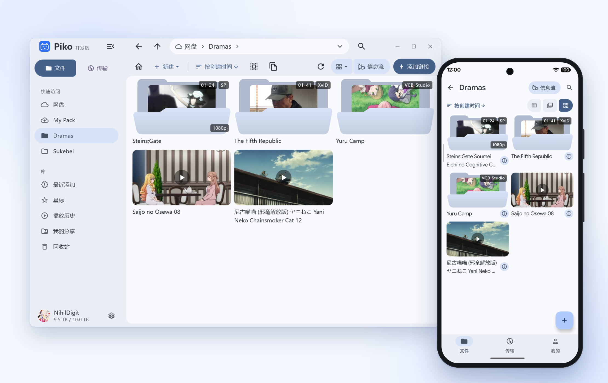
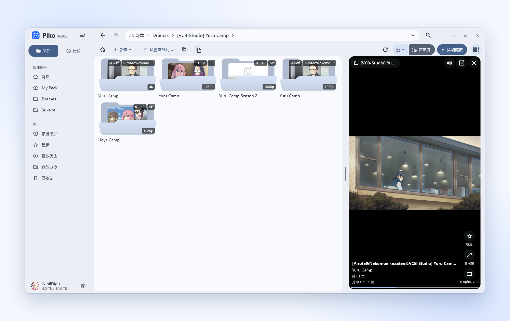
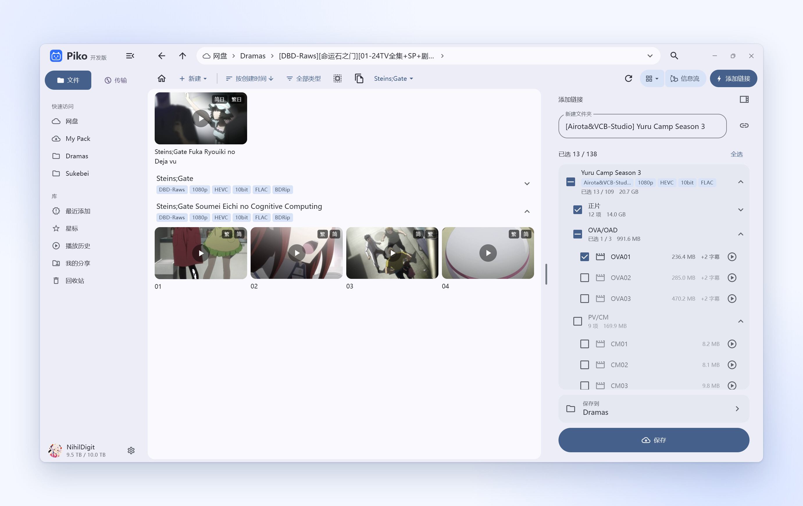
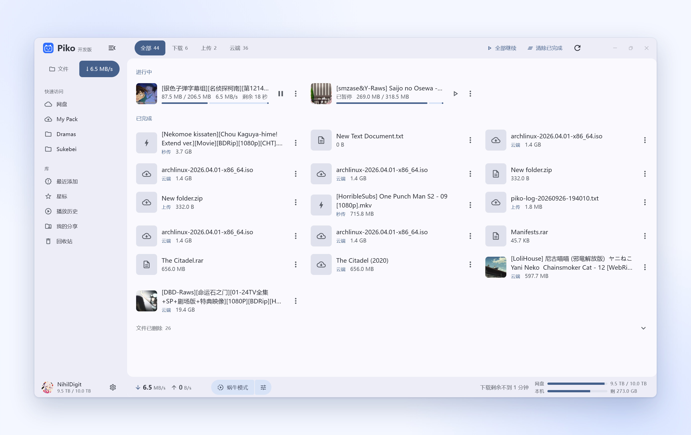
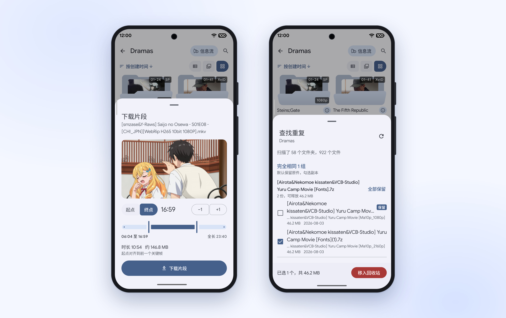

<a href="README.md">简体中文</a> | <b>繁體中文</b> | <a href="README.ko.md">한국어</a> | <a href="README.ja.md">日本語</a> | <a href="README.en.md">English</a>

<h1 align="center">Piko</h1>

<b>高效能、跨平台的 PikPak 用戶端</b> 
支援 Android、Windows、macOS、Linux、iOS 與 iPadOS

Telegram 更新頻道 <a href="https://t.me/piko_dev">@piko_dev</a> ｜ <a href="https://t.me/+mTkqVFyYnjszMjA1">交流群</a>

## 自適應版面配置

桌面端貼合鍵盤與滑鼠操作，行動端簡潔易用。支援多分頁與釘選資料夾、瀑布流看影片與圖片，以及唯讀掛載本機資料夾統一檢視。

<picture>
<source media="(prefers-color-scheme: dark)" srcset="https://raw.githubusercontent.com/NihilDigit/piko/main/docs/screenshots/hero-dark.jpg">

</picture>

## 資訊流

隨機播放目前資料夾或所選影片中的片段，上下滑動切換，支援自動順延與自動連播。

<picture>
<source media="(prefers-color-scheme: dark)" type="image/avif" srcset="https://raw.githubusercontent.com/NihilDigit/piko/main/docs/screenshots/feed-dark.avif">
<source type="image/avif" srcset="https://raw.githubusercontent.com/NihilDigit/piko/main/docs/screenshots/feed.avif">
<source media="(prefers-color-scheme: dark)" srcset="https://raw.githubusercontent.com/NihilDigit/piko/main/docs/screenshots/feed-dark.jpg">

</picture>

## 連結與壓縮檔

解析磁力、種子、ed2k、thunder、直連與分享連結，儲存前可預覽挑選或以參照形式免空間儲存；雲端壓縮檔免解壓縮直接瀏覽。劇集自動歸組，收起樣片與花絮。

<picture>
<source media="(prefers-color-scheme: dark)" srcset="https://raw.githubusercontent.com/NihilDigit/piko/main/docs/screenshots/links-dark.jpg">

</picture>

## 播放與傳輸

多連線並行繞開慢節點，最佳化高延遲與代理線路下的播放與下載；內建硬體解碼播放器，亦可呼叫外部播放器。蝸牛模式獨立限速，不影響播放。

<picture>
<source media="(prefers-color-scheme: dark)" srcset="https://raw.githubusercontent.com/NihilDigit/piko/main/docs/screenshots/transfers-dark.jpg">

</picture>

## 檔案處理

本機目錄樹支援全盤秒搜與空間分布圖，提供歸檔釋放空間、無損擷取片段、刮削批次重新命名與跨目錄查重。

<picture>
<source media="(prefers-color-scheme: dark)" srcset="https://raw.githubusercontent.com/NihilDigit/piko/main/docs/screenshots/tools-dark.jpg">

</picture>

## 帳號與同步

支援密碼與 Google 登入、多帳號切換。設定、釘選分頁與星標透過雲端硬碟自動跨裝置同步，壓縮檔密碼與刮削設定支援獨立口令加密。

## 安裝

前往 [Releases](https://github.com/NihilDigit/piko/releases/latest) 下載。安裝包均由 GitHub Actions 從原始碼建置，桌面端與 Android 端均支援應用程式內更新。

- **Android**：Android 8.0 及以上，按架構選 APK，不確定時選 `universal`。
- **Windows**：x64 需 Windows 10+，arm64 需 Windows 11+。`.msi` 為安裝版，`.7z` 為可攜版（Win10 可用 [NanaZip](https://apps.microsoft.com/detail/9n8g7tscl18r) 或 7-Zip 解壓縮）。
- **macOS**（實驗性）：macOS 12+（Apple 晶片），首次開啟需於「系統設定 → 隱私權與安全性」中放行。
- **Linux**（實驗性）：x64，需 glibc 2.38+（Ubuntu 24.04、Debian 13、Fedora 39+），AppImage 加上執行權限後即可執行。
- **iOS / iPadOS**（實驗性）：iOS 15+，未簽章 `.ipa`，透過 AltStore、SideStore、Sideloadly 或 TrollStore 自簽側載。

## 貢獻

路線圖見 [#10](https://github.com/NihilDigit/piko/issues/10)。

歡迎提交 Issue 與 PR。小型錯誤修復、崩潰排查與文件補充可直接提交。

計畫新增功能或調整架構時，請先建立 Issue 說明使用情境與擬定方案，確認方向後再實作。

使用 LLM 輔助編寫程式碼時，請理解新增程式碼的邏輯，並在實體裝置上驗證。

提交 PR 前須簽署[貢獻者協議](CLA.md)，簽署方式見 [CONTRIBUTING.md](CONTRIBUTING.md)。

## 授權與致謝

- 原始碼以 [AGPL-3.0-or-later](LICENSE) 授權條款開放原始碼。1.1.0 及更早版本以 MIT 授權條款發布。
  Android 安裝包內建以 GPLv3 建置的 mpv 與 FFmpeg。
- PikPak 介面實作參考了 [52funny/pikpakcli](https://github.com/52funny/pikpakcli)。
- 多項功能設計參考了 PikPak 網頁端增強腳本 [digbug82/PikPak_Enhancement_Master](https://github.com/digbug82/PikPak_Enhancement_Master)。
- Windows 端 mpv 的零拷貝渲染由 [MediaMP](https://github.com/open-ani/mediamp) 實作。

## Star History

<a href="https://www.star-history.com/#nihildigit/piko&Date">
<picture>
<source media="(prefers-color-scheme: dark)" srcset="https://api.star-history.com/svg?repos=nihildigit/piko&type=Date&theme=dark&legend=bottom-right">

</picture>
</a>
