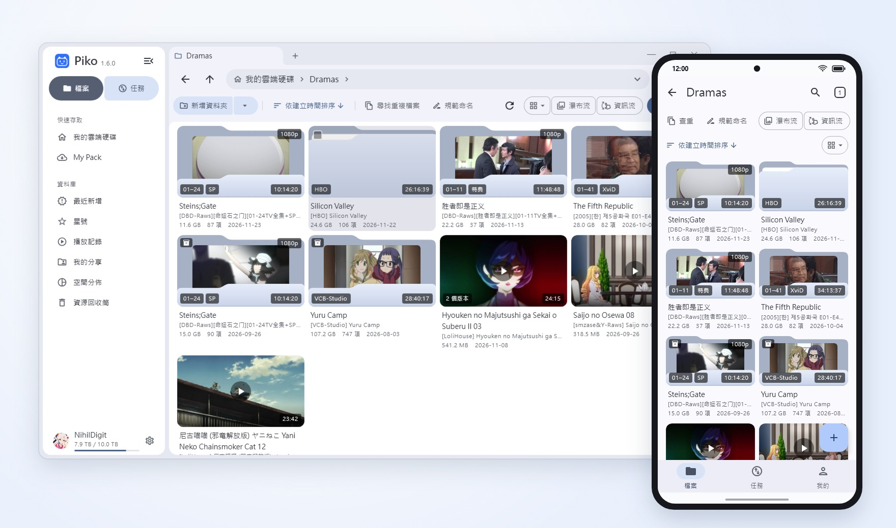
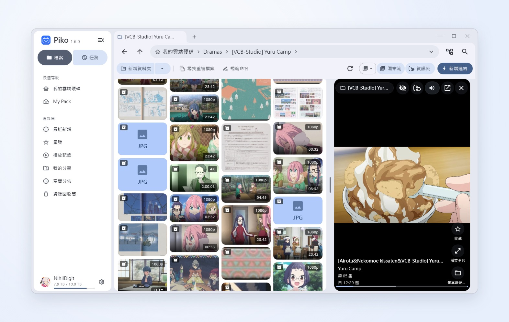
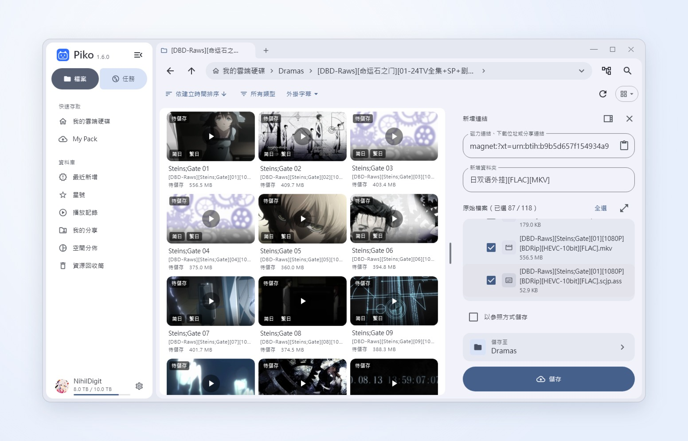
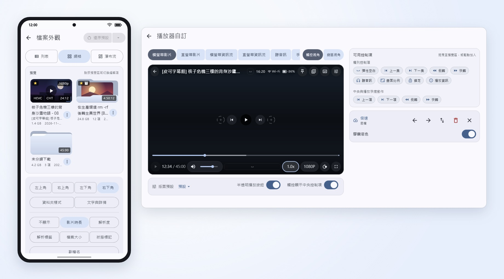

<a href="README.md">简体中文</a> | <b>繁體中文</b> | <a href="README.ko.md">한국어</a> | <a href="README.ja.md">日本語</a> | <a href="README.en.md">English</a>

<picture>
<source media="(prefers-color-scheme: dark)" type="image/avif" srcset="https://raw.githubusercontent.com/NihilDigit/piko/main/docs/banner-dark.avif">
<source type="image/avif" srcset="https://raw.githubusercontent.com/NihilDigit/piko/main/docs/banner.avif">
<source media="(prefers-color-scheme: dark)" srcset="https://raw.githubusercontent.com/NihilDigit/piko/main/docs/banner-dark.jpg">

</picture>

<b>優雅、易用、高效能的 PikPak 用戶端</b> 
支援 Android、Windows、macOS、Linux、iOS 與 iPadOS

Telegram 更新頻道 <a href="https://t.me/piko_dev">@piko_dev</a> ｜ <a href="https://t.me/+mTkqVFyYnjszMjA1">交流群</a>

## 工作區

面向大目錄瀏覽與多工整理，在桌面端與行動端均保持一致的流暢體驗，支援多分頁、釘選資料夾與本機資料夾掛載。

<picture>
<source media="(prefers-color-scheme: dark)" srcset="https://raw.githubusercontent.com/NihilDigit/piko/main/docs/screenshots/hero-zh-Hant-dark.jpg">

</picture>

## 瀏覽方式

利用瀑布流和資訊流，在大量影片與圖片中快速定位感興趣的內容。

<picture>
<source media="(prefers-color-scheme: dark)" type="image/avif" srcset="https://raw.githubusercontent.com/NihilDigit/piko/main/docs/screenshots/feed-zh-Hant-dark.avif">
<source type="image/avif" srcset="https://raw.githubusercontent.com/NihilDigit/piko/main/docs/screenshots/feed-zh-Hant.avif">
<source media="(prefers-color-scheme: dark)" srcset="https://raw.githubusercontent.com/NihilDigit/piko/main/docs/screenshots/feed-zh-Hant-dark.jpg">

</picture>

## 連結解析與壓縮檔

預解析磁力、種子與分享連結，儲存前預覽挑選或免空間參照；雲端壓縮檔免解壓縮直接瀏覽。

<picture>
<source media="(prefers-color-scheme: dark)" srcset="https://raw.githubusercontent.com/NihilDigit/piko/main/docs/screenshots/links-zh-Hant-dark.jpg">

</picture>

## 檔案處理

支援無損擷取影片片段、批次規範重新命名、跨目錄查重與歸檔釋放空間，並基於本機索引提供全盤秒搜與空間分布圖。

<picture>
<source media="(prefers-color-scheme: dark)" srcset="https://raw.githubusercontent.com/NihilDigit/piko/main/docs/screenshots/tools-zh-Hant-dark.jpg">

</picture>

## 自訂

按照你的使用習慣，自由調整檔案檢視與播放器介面。

<picture>
<source media="(prefers-color-scheme: dark)" srcset="https://raw.githubusercontent.com/NihilDigit/piko/main/docs/screenshots/customize-zh-Hant-dark.jpg">

</picture>

## 傳輸、帳號與同步

多連線並行繞開慢節點，最佳化高延遲與代理線路下的播放與下載；蝸牛模式獨立限速，不影響播放。

支援密碼與 Google 登入及多帳號切換。設定、釘選分頁與星標透過雲端硬碟跨裝置同步，壓縮檔密碼與刮削設定支援獨立口令加密。

## 安裝

前往 [Releases](https://github.com/NihilDigit/piko/releases/latest) 下載。專案原始碼完全開源，所有安裝包均由 GitHub Actions 從原始碼公開建置，附帶 [SLSA Build L3 來源證明](https://github.com/NihilDigit/piko/attestations)，建置流程全程可稽核；桌面端與 Android 端均支援應用程式內更新。

| 平台 | 支援狀態 | 系統需求 | 安裝包與說明 |
| --- | --- | --- | --- |
| **Android** | 正式支援 | Android 8.0+ | 按架構選擇 APK，不確定時選 `universal` |
| **Windows** | 正式支援 | x64 需 Windows 10+，arm64 需 Windows 11+ | `.msi` 安裝版或 `.7z` 可攜版（Win10 可用 [NanaZip](https://apps.microsoft.com/detail/9n8g7tscl18r) 或 7-Zip 解壓縮） |
| **macOS** | 實驗性 | macOS 12+（Apple 晶片） | 首次開啟需於「系統設定 → 隱私權與安全性」中放行 |
| **Linux** | 實驗性 | x64，glibc 2.38+（Ubuntu 24.04、Debian 13、Fedora 39+） | AppImage 加上執行權限後即可執行 |
| **iOS / iPadOS** | 實驗性 | iOS 15+ | 未簽章 `.ipa`，透過 AltStore、SideStore、Sideloadly 或 TrollStore 側載 |

## 貢獻

- 歡迎提交 Issue 與 PR；小型錯誤修復、崩潰排查與文件補充可直接提交 PR。
- **計畫新增較大功能或調整架構前請先建立 Issue**，說明使用情境與擬定方案，確認方向後再實作。
- **使用 LLM 輔助編寫程式碼時，須充分理解新增邏輯，並在實體裝置上完成驗證**。
- 提交 PR 前須簽署[貢獻者協議](CLA.md)，原始碼建置與提交流程詳見 [CONTRIBUTING.md](CONTRIBUTING.md)。

## 授權與致謝

- 原始碼以 [AGPL-3.0-or-later](LICENSE) 授權條款開放原始碼；Android 安裝包內建以 GPLv3 建置的 mpv 與 FFmpeg。
- PikPak 介面與部分設計思路參考了 [52funny/pikpakcli](https://github.com/52funny/pikpakcli)、[digbug82/PikPak_Enhancement_Master](https://github.com/digbug82/PikPak_Enhancement_Master) 與 [tonyflux/pkp](https://github.com/tonyflux/pkp) 等優秀的社群開源專案。
- 感謝 [open-ani](https://github.com/open-ani) 社群的 [Animeko](https://github.com/open-ani/animeko) 與 [MediaMP](https://github.com/open-ani/mediamp)：Piko 的桌面端播放基於 MediaMP，KMP 媒體應用與開源工程實踐也得益於在 Animeko 社群中的協作經歷。

## Star History

<a href="https://www.star-history.com/#nihildigit/piko&Date">
<picture>
<source media="(prefers-color-scheme: dark)" srcset="https://api.star-history.com/svg?repos=nihildigit/piko&type=Date&theme=dark&legend=bottom-right">

</picture>
</a>
