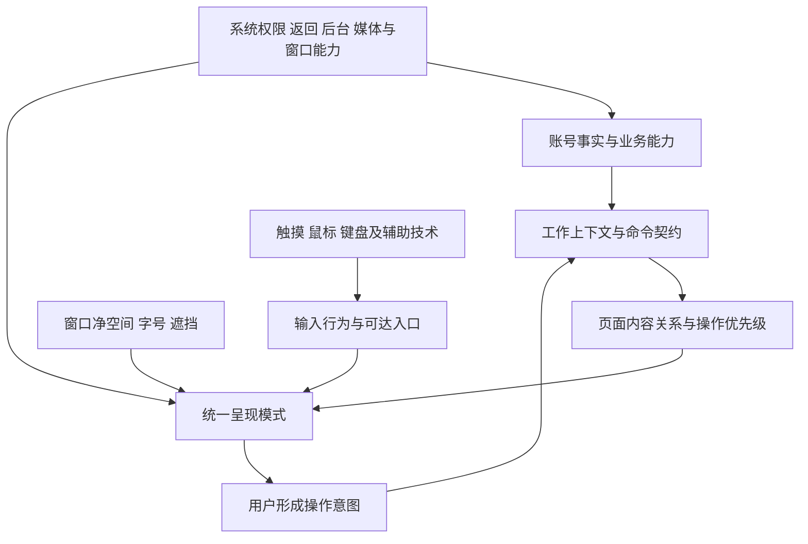

# Piko 共用能力与自适应交互设计规范

研究日期：2026-10-16。代码参照：`b4b54735`。

本文提出指导整个项目的设计方案，当前版本用于评审与原型验证。
研究依据为官方资料、docmirror4a 镜像和代表性代码。设备交互验证按第 9 节推进。
文中的“应”“不得”表示建议采用的项目规则；第 10 节列出官方依据及其适用范围。

## 1. 设计目标与基本关系

Piko 应让同一套业务能力在触摸和键鼠下都可理解、可发现、可完成，并随可用空间改变呈现。
Windows、Android、手机、平板、桌面模式用于构造验证场景；具体设计取决于业务、可用空间和输入能力。

“两套前端”指两套完整的操作体验：触摸以直接操作、明确入口和选择模式为主；键鼠以精确指向、
焦点导航和连续操作为主。两者共享工作身份、业务状态与命令规则，允许不同的操作编排和容器。
组件按稳定的交互语义复用，页面结构随操作流程和内容关系组织。

这几层通过明确的接口协作：业务与平台能力决定操作是否可用，输入要求决定命中区，布局决定内容排列和焦点顺序。
例如，系统分享入口取决于平台支持；复制操作在窄窗口中可收纳到菜单，继续保持可达。

### 必须保持的约束

1. 同一业务意图经按钮、菜单、快捷键或拖放提交，使用相同的命令规则与结果模型。
2. 窗口改变、旋转、键盘接入和输入方式交替不改变工作身份、默认目标或已经提交的执行。
3. 触摸、纯键盘都具有完整的基本操作路径；右键、悬停、拖放、双击是增强入口。
4. 同时存在的输入设备均可工作。最近一次鼠标事件不能关闭触摸入口或改变整页布局。
5. 模态关系由任务约束决定，内容位置和显示尺寸由布局决定。
6. 显示、隐藏、离开、关闭视图、丢弃草稿、停止执行和移除结果具有各自含义。
7. 页面遵循模式规则；新增例外需要说明原因、影响范围和验证方法。

## 2. 共用能力：前端共同遵循什么

### 2.1 能力契约

先用下表描述每项能力，再设计入口。下载、保存、扫描、撤销保留各自的领域模型，
使用统一的契约格式描述和审查。

| 契约项 | 必须回答的问题 |
| --- | --- |
| 对象与范围 | 哪个账号、哪些稳定对象 ID、哪个来源上下文；是当前项、选择集合还是整个目录？ |
| 输入 | 还需什么目标、参数或权限？默认值何时固定，何时允许更改？ |
| 可用性 | 不适用、平台不支持、暂时阻塞、可执行分别是什么？阻塞原因能否解释？ |
| 提交边界 | 点击何时成为已接受工作？重复触发怎样处理？提交时如何重新检查条件？ |
| 寿命 | 离开页面、关闭窗口、系统后台、换号及进程结束分别怎样处理？ |
| 结果 | 成功、部分成功、失败、未执行和结果不确定如何表示与查询？ |
| 后续动作 | 可否重查、重试、撤销、暂停、停止、定位产出或移除记录？分别作用于什么？ |
| 呈现信息 | 名称、对象摘要、进度与可恢复入口；不得要求业务层持有界面回调 |

可用性与入口优先级分开：不适用于对象的操作通常不显示；暂时受阻的相关操作保留原因；
次要操作可进入更多菜单。用户可通过原生无障碍入口或可聚焦说明读取阻塞原因，不能只依赖禁用按钮的悬停提示。
执行入口按提交时的账号、对象和权限重新检查条件，处理菜单打开后发生的状态变化。

以移动文件为例：发起时固定来源账号和源 ID，目标选择器有独立路径；取消选择不移动文件。
确认时重新检查源与目标，接受后形成稳定执行 ID。主列表变更选择不修改该执行；来源页面关闭后，
结果仍按契约查询。触摸端的“移动到”、鼠标拖放和键盘剪切粘贴可采用不同输入过程，最终调用相同移动规则。
拖放反馈应明确操作类型和目标，并与最终执行一致。

### 2.2 状态所有权

各上下文使用共同的状态模型和规则，按所有权分别持有状态实例。

| 状态 | 所有者 | 布局切换时的要求 |
| --- | --- | --- |
| 文件事实、权限、业务冲突 | 账号与服务 | 不复制成每个面板的事实源 |
| 已提交操作、回执、撤销依据 | 业务执行 | 不因界面卸载而停止或重复提交 |
| 导入草稿、扫描工作与报告身份 | 工作上下文/对应业务会话 | 保持身份；具体销毁由明确操作触发 |
| 路径、搜索、选择、范围锚点 | 浏览上下文 | 保持稳定；独立浏览上下文互不覆盖 |
| 可见详情对象、当前位置与返回关系 | 工作内导航 | 单栏与多栏映射同一对象关系 |
| 活动区域、栏宽偏好、工作切换器 | 窗口呈现 | 可重排；不得承担业务执行寿命 |
| 焦点恢复目标、滚动锚点 | 窗口中的具体视图 | 按对象身份恢复，而不是旧坐标或列表下标 |
| 悬停、按压、正在展开的菜单 | 控件与短暂交互 | 失效时可关闭，不改变选择或工作 |

同一报告的两份视图读取共同的报告事实，各自保留筛选与滚动；每个窗口独立持有活动焦点。
每项能力分别声明会话内保留、Activity 重建恢复和跨进程持久化的范围。

## 3. 两套交互如何共存

### 3.1 输入并存，呈现稳定

区分四种信息：可用设备能力、当前事件来源、明确的交互状态、用户设置。
事件来源决定此次手势如何解释；选择模式等显式状态决定对象是否可直接激活；用户设置决定稳定的密度偏好。
不得用“最后输入为鼠标”触发工具栏搬家、列表行高跳变、导航替换或草稿重建。

设备能力未知时采用可触控的默认尺寸和可见入口。检测到键鼠可增加快捷操作和提示；不能因此缩小命中区。
紧凑密度是可明确选择的呈现偏好，默认不随事件切换。混合输入的默认布局使用触摸可达基线。
高密度模式由用户显式选择，并单独验证其输入适用范围。

### 3.2 按对象语义定义激活与选择

Piko 按内容用途定义激活与选择：文件集合支持整理，导航列表切换目的地，任务列表展示执行详情。
下表结合 Windows、Material 和 GNOME 的交互惯例，给出各类内容的统一规则。[S2][S6][S7][S12]

| 模式 | 触摸 | 鼠标/触控板 | 键盘 |
| --- | --- | --- | --- |
| 文件、文件夹等可管理对象集合 | 默认轻点打开；可见“选择”入口或长按进入批量选择；选择模式下轻点切换勾选 | 默认单击选中，双击打开；修饰键加选/范围选择；菜单也有“打开” | 方向键导航，Enter 打开；Space 切换勾选，修饰键扩展选择 |
| 导航目录、设置类别、固定目的地 | 轻点进入 | 单击进入 | 焦点与激活分离，Enter/Space 激活；具体树控件遵循树导航规则 |
| 任务与结果列表 | 默认轻点查看详情；显式批量模式下勾选 | 默认单击查看详情；复选框/选择入口用于批量操作 | 方向键移动，Enter 详情，Space 勾选；焦点移动本身不启动或取消任务 |
| 导入文件树等以选择为主的控件 | 勾选控制是否包含；展开按钮只展开 | 相同；支持有明确范围的加选 | 展开、焦点移动与勾选分开；全选只作用于声明范围 |
| 按钮、表单、媒体控件 | 按控件语义直接操作 | 按控件语义直接操作 | 使用标准控件键位，不套文件集合规则 |

同一文件集合的列表、网格、画廊视图使用同一选择语义；图像浏览器中的上一张/下一张采用媒体导航规则。

### 3.3 选择模型的具体约定

- 焦点项、选择集合、范围锚点、当前详情对象分别表示，批量命令读取明确的选择集合。
- 文件集合普通鼠标单击替换选择，Ctrl/平台主修饰键点击切换单项，Shift 选择锚点到目标的当前排序范围。
  Shift 与主修饰键组合表示追加范围。排序改变后重设范围锚点，选择仍按 ID 保存。
- 普通方向键在文件集合中移动焦点并选择该项；Ctrl+方向键只移焦点；Shift+方向键扩展范围。
  在表单、树或导航列表中遵循对应控件规则，不全局截获。
- 显式批量选择模式优先于事件来源：进入后触摸和鼠标普通点击均切换勾选，打开通过明确入口完成。
  接入或拿走鼠标不退出该模式；取消选择才退出。鼠标普通单选本身不强迫进入触摸的全行勾选模式。
- 右键已选项作用于当前选择集合；右键未选项先明确将目标设为该项，再显示单项菜单。
  行内“更多”始终针对该行，批量操作由选择操作栏提供；菜单标题或摘要注明对象与数量。
- 长按进入选择，不同时弹出上下文菜单或开始拖放。第一阶段不提供长按拖动批选与长按拖放的重叠手势。
- 点击行内按钮只执行该按钮，不透传成整行激活或选中。触控滚动取消点击判定，不在按下时提交破坏性操作。
- 全选限定当前浏览范围；若分页或尚未加载，应显示“已加载 N 项”或另设服务器全量选择能力，不能暗示全部已选。
- 本方案默认在改变目录、搜索或过滤范围时清空批量选择；仅排序和布局改变保留。
  隐藏后仍选中的产品需求须另有明确计数与审阅入口，不能无提示地跨范围批量删除。
- 对象从数据源消失时移除其选择，并将焦点交给相邻可用项；禁止依据旧行号操作新条目。

### 3.4 命令、焦点、手势与可发现性

基本操作提供可见入口，长按、右键、快捷键、滚轮和框选用于加速。
触摸操作位置按窗口宽高、可达性与遮挡安排，宽触屏可在内容附近提供操作栏。
命令分为页面、选择集合、单对象三种作用域；工具栏标题与计数应使作用域可辨认。

键盘先保证导航，再增加快捷键。Tab 在区域与控件间移动，集合内部由方向键导航，避免每行多个按钮形成
数百个 Tab 停靠点；行内动作通过可进入的操作区域或菜单可达。焦点框与选择标记不同；
输入框处理自己的文字编辑、输入法确认和撤销，不能被页面 Ctrl+A、Delete、Space 或 Enter 抢走。[S5]

弹层打开时仅在需要交互时转移焦点，关闭后返回触发项；触发项已删除则返回邻近项或列表入口。
后台完成和新出现的辅助栏不抢焦点。区域可见但未活动时，其选择仍可见；键盘命令作用于焦点所在区域。
快捷键展示遵循平台修饰键，避免覆盖系统保留组合；读屏的无障碍焦点与键盘焦点分别验证。

拖放必须有复制/移动按钮替代；分隔条拖宽必须有键盘调节和重置/预设入口。
滚轮不应触发关闭 Sheet 或换工作；触摸滚动与拖动以统一手势仲裁规则区分。笔作为独立事件来源处理，
不因支持悬停就假设有鼠标右键；按钮能力按实际可用情况增强。[S10]

## 4. 响应式布局的统一决策方法

### 4.1 先定义内容关系，再测容量

页面声明内容模式、操作优先级和容量需求。
布局决策顺序为：内容关系 → 当前工作与用户意图 → 内容净空间 → 输入命中约束 → 呈现方案。
宽高都以逻辑单位衡量；物理屏幕分辨率和“横屏/竖屏”不作为充足条件。[S1][S3]

外壳用窗口尺寸安排导航；内部用扣除导航、系统安全区、输入法遮挡和固定控件后的容器尺寸判断并列。
遮挡只计算一次。已调整窗口高度的平台不能再重复扣除输入法高度。
折叠设备需要按可用区域检查，不能将铰链两边的总宽直接当作一块连续内容区。

并列布局的基本判据是：

`内容净宽 ≥ 主区最小宽 + 辅区最小宽 + 间隔`，并且两区都有足够可操作高度。

每种模式通过内容样例和字号验证确定最小宽高，并记录容量预算。
600/840/1200/1600 dp 用作外壳研究与测试的起点，内容区按实际预算决定并列。
宽高比用于安排图片、视频等内容及选择候选布局。宽而低时，先减少固定占用与重排操作，再判断是否退为单栏。

### 4.2 允许的变换及其条件

| 变换 | 使用条件 | 不变量 |
| --- | --- | --- |
| 内容重排 | 同一任务内部的表单、卡片或元数据可换行/换列 | 阅读顺序、字段值、焦点对象 |
| 展开/收纳导航 | 标签和导航宽度预算变化 | 目的地集合、名称与选中项 |
| 命令溢出 | 完整常用动作放不下 | 稳定优先级和分组，菜单仍可完成全部适用操作 |
| 并列转逐页 | 相关内容无法同时可用 | 当前目标、来源关系、返回路径、各自滚动位置 |
| 辅助内容按需显示 | 辅助内容未打开或容量不足 | 显式打开意图；重新变宽不强开用户已关闭的栏 |
| 容器替换 | 相同任务从浮层转全屏等 | 模态关系、草稿、提交边界和关闭含义 |

空间增大后，正文按阅读宽度限宽，图片网格可增加列数，视频可保持单区沉浸。
新工作和属性面板由用户主动打开。各页面按共同规则选择适合内容的布局。

### 4.3 宽窄转换状态

必须分别记录“用户想打开什么”和“当前能显示什么”。窗口缩窄导致辅助栏暂时不可见，不等于用户关闭它。
用户关闭后再变宽也不应复活该栏。栏宽偏好与当前夹取宽度分开，临时小窗口不覆盖原偏好。

缩为单栏时优先显示用户正在操作的逻辑目的地：正在编辑配置则保留配置；正在读任务详情则保留详情。
没有直接交互时按最近显式导航目标选择；单纯鼠标悬停不能改变这一目标。
在双栏中选择详情后缩窄，返回应能到列表；仅拖大再拖小不能额外压入多层返回记录。
恢复宽布局时复用原对象与内容状态，不重新提交、重新解析或重复挂载媒体宿主。

重排应保留正在输入、拖动或选择目标的逻辑操作。
模式层负责避免断点附近的测量反馈循环；需要滞回阈值时，通过统一的边界测试确定。

### 4.4 尺寸、密度与文字

默认触摸可用控件以至少 48×48 dp 命中区为基线，图标可以更小；相邻命中区不可重叠争抢事件。
该基线采用 Android/Material 的触摸目标建议。[S9]
跨平台比较尺寸时，应分别核对 CSS px、Apple pt 和 Compose dp 的缩放与命中规则。

空间不足时优先移除次要元数据、收纳次要操作、重排和单栏回退；不缩小系统字号、不裁掉错误说明和提交按钮。
低高度或大字号下固定头尾栏可以改随内容滚动，保证表单正文仍可到达。操作顺序不能随每次测量任意变化。
紧凑密度、文件缩略图缩放和系统字体缩放是不同偏好，不能互相覆盖。

## 5. 项目统一呈现模式

| 模式 | 用途与宽布局 | 窄布局 | 输入与寿命约束 |
| --- | --- | --- | --- |
| P1 对象集合 | 文件、星标、回收站、查重文件；列表或网格，可有明确辅助内容 | 同一集合，减少元数据与收纳命令 | 使用统一文件选择规则；同一上下文不因视图切换丢选择 |
| P2 列表—详情 | 任务列表和执行详情、设置类别和正文 | 当前目的地逐页显示 | 详情 ID 独立于批量选择；返回回来源，尺寸切换不重复导航 |
| P3 主内容—辅助内容 | 文件与信息流、报告树与报告摘要 | 按需切换到辅助内容并保留来源 | 主辅关系明确；辅助隐藏不自动结束业务工作 |
| P4 工作编辑器 | 导入树与目标/参数、批量改名预览与配置 | 工作内分区或逐步浏览，共有明确提交点 | 共用草稿；分区切换不是提交、关闭或新工作 |
| P5 短事务 | 改名、目标选择、密码或确认；紧凑对话框 | 必要时全屏 | 固定操作对象，背景不可改变本次源；取消仅取消尚未提交的输入 |
| P6 独立工作切换 | 多文件上下文、导入、查重；空间够时可用可关闭工作标签 | 工作切换器 | 身份、顺序、恢复和关闭规则统一；功能分类标签不混入工作实例 |
| P7 媒体体验 | 播放器、信息流主观看；内容可保持单区 | 控件按可用宽高重排 | 播放会话单一所有者；播放/暂停、进度和音量有可见替代操作 |

P2 展示列表对象的详情；P3 中的辅助内容保留自己的上下文，例如信息流的范围和播放位置。
需要跨页面参照、保留并恢复的编辑工作采用 P4；为一次操作收集所缺输入采用 P5。
容器选择取决于任务的持续性和上下文关系，可结合 Fluent 对 Drawer 复杂度的建议评估。[S8]

属性作为主动打开的固定对象信息采用临时信息面，不默认常驻跟随选择，也不抢占已经打开的信息流。
短信息面可浮动或覆盖；内容很多时转完整信息页。适配必须保留对象和关闭返回关系。
全屏和浮层使用相同的工作关闭规则。[S11]

导航底栏、Rail、侧栏保持同一组目的地和词汇；工作标签、筛选分类、详情内标签属于不同层级。
宽触屏可以显示可触达的工作标签，窄键鼠可以用工作切换器；多工作能力不随是否显示标签而开关。
具体是否开放多个主文件工作尚需样板验证，但已存在的工作不得因窗口变窄而丢弃。

### 5.1 各业务如何应用模式

下表将各业务映射到呈现模式，并列出实施前需要核对的业务契约。

| 业务 | 模式组合 | 需要固定的业务边界 |
| --- | --- | --- |
| 主文件、星标、历史、回收站 | P1；必要时 P5 | 真实文件动作、历史记录移除和回收站清空是不同命令；列表外观不抹平区别 |
| 目录图与画廊 | P1 的内容视图 | 共享对象身份与选择；改变视图不改变操作集合，目录图展开不等于进入目录 |
| 导入链接、秒传、分享接收 | P4 + P5 + P6 | 草稿目标、预览资源和已接受保存分开；每份草稿独立 |
| 本机上传 | 平台选择器 + P2 | 来源授权属于准备/上传寿命，平台选择器返回不等于文件已可持续读取 |
| 下载与指定画质 | P5 + P2 | 普通下载与指定画质入口明确；准备、下载、转封装的反馈保持一致 |
| 查重 | P4/P3 + P1 + P6 | 扫描身份、报告内容、报告浏览及文件删除分别管理 |
| 批量改名与规范命名 | P4 | 预览与应用有明确边界；目标集合固定，冲突修改后重新核对 |
| 归档、取回和清单编辑 | P1 + P5 + P2 | 云端文件与归档记录区分；部分完成和撤销各有明确对象 |
| 压缩包浏览与解压 | P1 + P5 + P2 | 压缩包条目不假扮真实网盘文件；密码输入、浏览资源与解压执行寿命分开 |
| 创建分享、我的分享 | P5/P4 + P2 | 生成分享与撤销分享分别提交；链接失效和记录移除区别表达 |
| 任务与执行结果 | P2 | 按稳定执行 ID 展示详情；批量命令只覆盖真实支持的执行类型 |
| 信息流与播放器 | P3/P7 | 播放范围、观看位置与文件浏览位置独立；转场保持唯一宿主 |
| 设置、WebDAV、代理与服务配置 | P2 + P5 | 立即生效项与需提交项明确区分；切分类不隐式丢弃编辑 |
| 登录、账号切换、应用更新 | 表单/短事务 + 平台能力 | 账号切换影响哪些工作需有明确契约；更新退出与普通窗口关闭分别处理 |

### 5.2 关键方案取舍

| 问题 | 本方案建议 | 取舍依据与验证点 |
| --- | --- | --- |
| 两套独立页面树还是共用页面 | 按语义共用工作模型和模式，允许模式内部不同布局 | 两套树容易偏离业务语义；单一巨型页面容易积累条件。通过样板决定组件边界 |
| 自动切“触摸模式/桌面模式”还是并存 | 输入行为并存，密度稳定 | 混合输入频繁切换，自动换壳会移动目标；检查触摸后鼠标和鼠标后触摸是否仍可预测 |
| 所有列表统一单击行为还是按类型 | 文件对象与导航/任务详情分开，类型内统一 | 文件整理需要选择，任务阅读需要进入详情；以误打开、误选择和批量效率验证 |
| 使用全局断点还是每页自由适配 | 外壳档位共用，内容模式按登记的容量预算布局 | 全局断点不代表每种内容放得下，每页自定又失去一致性；模式统一管理预算与回退 |
| 自动常驻详情还是主动打开 | 对象属性主动打开，列表详情随明确导航显示 | 文件选择用于管理，不必同时查看属性；检查工作空间占用与对象混淆 |
| 任意两个工作并列还是相关内容并列 | 第一阶段做好相关内容，多工作先统一切换 | 独立工作并列还涉及双导航、焦点、命令范围与关闭关系；按实际对照需求另行设计 |

## 6. 返回、关闭与执行结果

### 6.1 动词必须对应明确后果

| 操作 | 后果 |
| --- | --- |
| 返回 | 退出局部输入/选择或回上一个逻辑位置，不隐式停止后台业务 |
| 收起/切换工作 | 保留可恢复的工作，上屏内容改变 |
| 关闭视图 | 解除视图与工作的展示关系；若会丢失工作，必须使用明确的丢弃/移除语义 |
| 丢弃草稿 | 删除未提交编辑；必要时说明损失；不撤回已接受执行 |
| 停止扫描 | 停止继续收集，是否保留部分报告由能力契约决定 |
| 暂停传输/取消远端任务 | 按实际业务能力分别命名和执行 |
| 移除结果 | 移除记录，不撤销产出；不确定结果需说明原操作可能已执行 |
| 撤销 | 对指定已确认结果发起反向操作，拥有自己的成功与失败结果 |

建议优先把“离开”做成保留工作，把“丢弃”做成明确动作。若产品最终要求关闭标签即移除对应草稿，
工作标签与切换器必须采用同样规则和确认，不允许触摸的 X 与键鼠的 X 后果不同。

### 6.2 返回分派

系统/输入法先处理其消费的返回；应用内再按当前可交互范围处理：顶层弹层 → 显式选择模式 →
活动区域内导航 → 工作来源关系 → 顶层目的地/系统。每次只处理一层，隐藏区域不得消费返回。
每种模式应给出具体的返回轨迹，并明确当前选择是否参与返回处理。

Esc 用于退出局部菜单、弹层、选择或全屏，不全局等同系统返回。未提交编辑遇到 Esc/返回遵循相同的保留规则。
关闭应用窗口的后台行为由系统与执行契约决定；它与关闭工作标签不使用同一个业务动作。

### 6.3 执行与结果

工作切换器回答“还能回到哪些工作”，任务入口回答“哪些执行在进行、待处理或已有结果”。
两者通过工作与执行的关联互相链接。徽标按稳定口径分别表示运行数、待处理数或未读结果数，
并在入口处说明含义。

操作接受后立即提供反馈，结果可离开页面后查看。短提示辅助发现，不能是唯一结果来源。
自动重试只用于业务明确允许的范围；远端结果未知时展示核对/重查能力，不通用地显示“重试”。
详情通过执行 ID 读取最新状态，排序或过滤改变不得跳到另一项执行。

## 7. 用完整流程检验规则

### A. 文件选择、移动和结果

1. 在文件集合选择两项；触摸使用显式选择模式，鼠标使用加选，键盘使用焦点与选择命令。
2. 发起移动时固定源集合并显示摘要；打开有独立路径的目标选择器。
3. 缩窄窗口、展开输入法或切换输入设备，源和目标保持；返回只退出目标选择，不移动文件。
4. 提交被接受后关闭来源视图；任务中仍显示同一执行，完成后可定位目标或按能力撤销。
5. 检查所有入口提交参数等价，没有重复请求；文本框 Delete 不触发文件删除。

### B. 导入工作内部重排

打开两份不同目标的草稿；在一份中勾选并编辑目标。宽布局为树与配置并列，窄布局保留当前编辑区，
可返回另一分区，两区属于同一工作。接鼠标、旋转和弹键盘保持解析结果与默认目标。
提交后同一执行在任务中可查，继续编辑另一草稿保留已提交参数；跨进程恢复按草稿契约单独验证。

### C. 任务详情与动态列表

任务列表单击/轻点查看详情；后台完成导致排序变化，详情仍绑定原执行。进入批量模式不让“详情对象”
自动加入批量集合；窄宽往返不复制返回记录。移除当前结果后焦点落到相邻项，所有破坏性批量操作展示数量。

### D. 文件与信息流

宽布局从信息流定位文件时保留信息流队列，暂停当前片段并在文件区定位；这遵循既有研究明确的产品意图。
窄布局进入临时文件位置并保留返回信息流的关系。窗口来回变化时只有一个播放器宿主，不重新选取播放范围，
定位操作保留主文件工作的原位置。平台原型应验证宿主迁移、播放连续性和资源释放。

### E. 查重与设置的模式选择

查重报告中的文件是可管理对象，采用 P1；查重类别采用导航/筛选交互，单击即可切换。
设置类别采用 P2，单击展示正文。文件属性由用户主动打开。
验证这些相似外观下的不同操作，确认组件按语义复用。

## 8. 如何落实为可维护的项目设计

### 8.1 责任分配

| 层级 | 集中维护的内容 | 页面声明的内容 |
| --- | --- | --- |
| 领域能力 | 适用性、执行复核、参数、寿命、结果和后续动作 | 使用哪个能力、传入什么对象 |
| 工作模型 | 身份、草稿、导航上下文、恢复与释放 | 工作类型及业务状态来源 |
| 交互模式 | 选择、激活、焦点、返回、菜单目标和手势仲裁 | 集合语义、允许的交互、操作作用域 |
| 布局模式 | 容量判断、重排、宽窄映射、栏宽与容器转换 | 主辅关系、最小内容预算、优先级 |
| 基础控件 | 命中区、按压/悬停/焦点、语义和标准键盘行为 | 标签、值和行为绑定 |
| 平台适配 | 权限、系统返回、后台、窗口与媒体能力 | 所需能力，不能直接选择整个页面模型 |

集中规则由小型策略函数、模式组件和类型化状态承接，具体组件边界通过样板确定。
页面不能自行按操作系统隐藏通用能力、改变点击语义或增加未经登记的断点。
业务特有行为由业务层定义，例如停止扫描后保留报告、暂停上传后保留可续传状态。

### 8.2 每个页面/模式的设计卡

评审时必须填写以下项目，未明确前不进入逐页面调样式：

- 用户目标、内容对象及主要操作；属于哪个模式，是否存在必要例外。
- 能力契约和作用域，输入与结果何时固定，操作禁用/隐藏原因。
- 状态所有者、稳定 ID、会话内与跨进程恢复边界。
- 触摸、鼠标、纯键盘路径；焦点、选择、展开和激活各自的含义。
- 容量预算、操作收纳次序、窄宽转换表、最小高度与大字号回退。
- 返回/Esc/关闭/收起轨迹，丢弃与停止是否独立。
- 加载、空态、错误、部分成功、待输入与未知结果。
- 无障碍名称与操作、验证场景，以及例外的依据与退出条件。

例外登记至少包含：违反哪条默认规则、真实业务理由、可见差异、受影响组件与测试。
相同例外出现第二次时复审模式是否缺少一种语义，不继续复制页面条件。

### 8.3 初稿提交如何处理

前八个提交按能力契约和完整流程的验收结果决定保留或重写。
`17a09525` 的按平台工作区分支和 `30357f81` 的任务/导航组织重点复审；写入、保存、上传、资源隔离的
领域模型可作为候选基础，仍需验证实际寿命与结果。`70960571` 的画质动作可独立审查。
`da38dac1` 的测试记录用于追溯旧实现，新规范按第 9 节验收。完整提交映射见 [积压工作复审](tablet-interaction-research.md)。

已确认的代码证据：

| 入口 | 当前事实 | 需要的设计变化 |
| --- | --- | --- |
| `ui/.../adaptive/FormFactor.kt` | 平台固定 Desktop/Mobile，宽度主要改密度 | 逐项拆出空间、输入与系统能力职责 |
| `ui/.../workbench/WorkspaceViewModel.kt` | `desktop` 决定两种工作区实现 | 先确定共用上下文和不同导航投影，再评估类的合并；不能随窗口替换实例 |
| `ui/.../PikoMainScaffold.kt` | 信息流并列准入依赖 desktop | 使用 P3 容量与导航规则 |
| `ui/.../screens/drive/DriveScreen.kt` | desktop 同时控制 twoPane、更多按钮和部分命令 | 分离布局、可见入口与能力适用性 |
| `ui/.../components/SelectionClicks.kt` | 文件鼠标处理与触摸处理分开，注释说明焦点承担部分点选含义 | 显式区分焦点和选择，验证子按钮事件仲裁 |
| `ui/.../screens/transfers/TransferSelection.kt` | 另写鼠标点选处理，普通点选落入任务选择集合 | 按 P2 与批量模式重新定义，不直接复制文件规则 |
| `shared/.../state/FileWriteModels.kt` | 命令无 UI 回调，结果区分已确认与不确定等集合 | 可作为能力契约的现有例子，不假定其他领域都已等价实现 |

上述事实来自对表中入口的静态代码检查。

## 9. 验证与实施顺序

### 9.1 验证矩阵

| 维度 | 必须覆盖的组合/变化 | 观察结果 |
| --- | --- | --- |
| 空间 | 窄且高、宽且低、宽且高；每个实际容量边界前后；连续拖动 | 主要操作可达、无重排循环、目标与选择保持 |
| 输入 | 纯触摸、鼠标无键盘、纯键盘、混合交替、设备断开 | 全流程完成，状态不重置，无只靠悬停或手势的入口 |
| 字号/缩放/IME | 默认与大字号、显示缩放、编辑中展开输入法 | 焦点和输入保持，正文与提交区域可达，命中区不重叠 |
| 平台 | Windows 触屏与键鼠；Android 触屏与外接键鼠/桌面窗口 | 事件真实到达，系统返回、权限与后台策略正确 |
| 生命周期 | 内容隐藏、布局换宿主、Activity 重建、窗口关闭、换号 | 执行次数不增加、无旧账号回调、资源不误释放 |
| 辅助技术 | 键盘焦点、读屏、减少动画与高对比需求 | 名称/状态/操作可读，焦点可定位，信息不只依赖颜色 |

Android TV 另行验证远距离阅读、D-pad/遥控器焦点图和返回行为。
笔、折叠铰链、系统多窗口与外接显示分别记录实际设备、系统版本和通过场景。

### 9.2 验收标准

每个样板流程必须经触摸和纯键盘完成，鼠标增强路径也完成；往返切换布局后使用同一工作 ID 和目标。
记录命令接受次数、结果 ID、焦点对象和资源实例，才能识别重复提交、错对象与双播。
测试应包括业务状态动态变化，而非只验证固定截图。

规则函数测试负责选择与命令作用域、容量和导航映射；交互测试负责焦点、返回和事件仲裁；
截图负责布局、文字及入口；平台实测负责系统输入、权限、生命周期与原生媒体。
验证报告分别记录模拟结果和设备实测结果。

### 9.3 分阶段推进

1. 评审本文的操作语义与模式目录，确认候选决定；补齐关键能力契约，不改动提交历史。
2. 制作文件管理、导入编辑、任务详情三个可操作样板，覆盖触摸/键鼠与窄宽转换。
3. 用样板验证单击、批量选择、工作关闭与导航映射。失败时修订规范，再决定组件抽象。
4. 实现共用选择/命令入口与模式容器，逐条迁移完整流程；不先全局替换 desktop 判断。
5. 扩展至查重、信息流、设置、媒体和其他业务，登记必要例外；完成实机矩阵后才评价是否可用。

本轮交付到第一阶段的研究方案。下一阶段的关键验证问题：任务列表单击详情是否符合高频管理需要；
触摸显式选择与鼠标默认选择共存是否清晰；工作标签关闭与工作保留的表达是否可理解；
各模式真实内容的最小宽高及大字号回退是否足够。它们已有候选方案，尚无用户试用结论。

## 10. 来源与适用边界

本地镜像根目录为相邻 `docmirror4a`；下表以其中子目录的 `pages/` 为相对根。
标为“在线”的资料于 2026-10-16 阅读正文；镜像内容及版本以文件自带元数据为准。
Windows 选择模式使用 S6 的现行页面。Win32 鼠标指南是 Windows 7 历史资料，用于解释传统对象选择惯例。

| 编号 | 原始资料与读取方式 | 本文采用的依据及限制 |
| --- | --- | --- |
| S1 | [Material Breakpoints](https://m3.material.io/foundations/layout/breakpoints)，镜像 `m3-material-mirror/foundations/layout/breakpoints.md` | 布局可按容量展开、收纳和重排；断点不代表设备能力，不直接决定 Piko 每栏预算 |
| S2 | [Material Inputs](https://m3.material.io/foundations/interaction/inputs)、[Selection](https://m3.material.io/foundations/interaction/selection)，镜像 `m3-material-mirror/foundations/interaction/` 对应文件 | 多种输入可以共存，选择模式和手势冲突需明确；不直接套用为所有列表的默认点击语义 |
| S3 | [Android Window size classes](https://developer.android.com/develop/ui/compose/layouts/adaptive/use-window-size-classes)，在线及 Android 镜像同路径 | 根据应用可用区域分别划分宽度和高度档位 |
| S4 | [Android Input compatibility](https://developer.android.com/develop/ui/compose/touch-input/input-compatibility-on-large-screens)，在线及同路径镜像 | 键盘导航、按键与快捷键分别处理；自定义控件逐项验证外接输入支持 |
| S5 | [WAI-ARIA Keyboard interface](https://www.w3.org/WAI/ARIA/apg/practices/keyboard-interface/)，在线 | 采用焦点与选择分离、组件内外导航及基本可达性原则；实现使用 Compose 对应机制 |
| S6 | [Windows Selection modes](https://learn.microsoft.com/en-us/windows/apps/develop/ui/controls/selection-modes)，在线 | 单选、多选与扩展选择具有不同语义；选择模式应有明确范围，不由屏幕宽度触发 |
| S7 | [Windows Mouse and Pointers](https://learn.microsoft.com/en-us/windows/win32/uxguide/inter-mouse)，在线，历史指南 | 用于理解传统文件对象的单击选择与双击激活；适用范围为对象集合 |
| S8 | [Fluent Drawer](https://fluent2.microsoft.design/components/web/react/core/drawer/usage/)，镜像 `fluent-design-mirror/components/web/react/core/drawer/usage.md` | 并列与覆盖用途不同，复杂工作需合适空间；未采用其所有 Web 组件行为和尺寸 |
| S9 | [Compose API defaults](https://developer.android.com/develop/ui/compose/accessibility/api-defaults)，在线 | 48 dp 触摸目标及标准语义作为基线；仍需检查自定义控件与命中边界 |
| S10 | [W3C Dragging movements](https://www.w3.org/WAI/WCAG22/Understanding/dragging-movements)，在线 | 采用无需拖动的指针替代路径，作为操作可达性的设计与验收要求 |
| S11 | [Apple Modality](https://developer.apple.com/design/human-interface-guidelines/modality)、[Pointing devices](https://developer.apple.com/design/human-interface-guidelines/pointing-devices)，镜像 `apple-hig-mirror/` 对应文件 | 模态是交互限制，指针可与触摸共存；不移植 Apple 系统窗口或指针视觉 |
| S12 | [GNOME Selection & Edit Modes](https://developer.gnome.org/hig/patterns/containers/selection-mode.html)，镜像 `gnome-hig-mirror/patterns/containers/selection-mode.md` | 集合可显式进入批量操作；其操作数门槛和右键选中规则未直接采用 |
| S13 | [Material Canonical examples](https://m3.material.io/foundations/layout/canonical-examples)、[Android Supporting pane](https://developer.android.com/develop/ui/compose/layouts/adaptive/build-a-supporting-pane-layout)，对应本地镜像 | 列表详情与主辅内容表达不同关系；库容器是实现候选，不替代工作和返回语义设计 |

## 11. 与已有文档的关系

本文作为新一轮项目级设计的入口。
[交互研究](interaction-design-research.md) 和 [平板研究](tablet-interaction-research.md) 保留早期证据与局部方案；
[重构审查](interaction-refactor-review.md)、[推进记录](interaction-refactor.md) 和 [工作区验证](interaction-workspace-validation.md)
用于追溯实施与验证，时间敏感描述应结合各自基线阅读。
当新规范通过样板并进入实施时，同步更新对应模块指导，避免新方案与历史完成记录混写。
