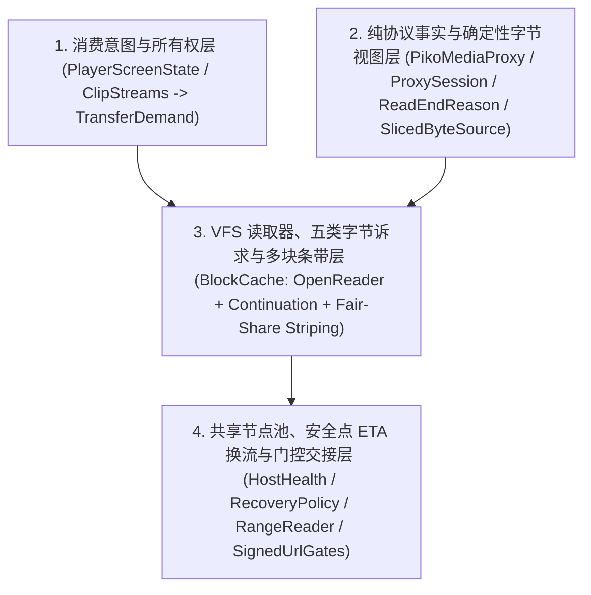

# PikPak CDN 传输习性实测与流式缓存正交架构（2026-11-10）

本文记录 2026-11-10 针对 PikPak CDN（`dl-z01a-*.mypikpak.com`）在多地区专线与普通机场线路下的实测数据、旧版状态机组合爆炸的根因剖析，以及由此确立的四层正交取流架构。

---

## 一、实测环境与方法

- **测试样本**：318 MiB 1080p MKV 原画文件（`1920x1080`，`matroska,webm`，平均码率 `1837 kbps`，时长 `1420s`），同时具备云端转码流 `1080P`（155 MiB `mpegts`，`897 kbps`）、`720P`（99 MiB `mpegts`，`572 kbps`）、`480P`（69 MiB `mpegts`，`400 kbps`）。
- **网络接入方式**：通过独立 `mihomo` 核心直接绑定物理网卡 `Wi-Fi 2` 并使用 DoH（`https://223.5.5.5/dns-query`）解析节点域名，绕过本机 TUN 虚拟网卡与 UDP 53 Fake-IP 劫持，分别在 9 条代表性代理线路上执行对照实测：
  1. **专线组（Nexitally）**：新加坡（`NEX-SG`）、香港（`NEX-HK`）、日本（`NEX-JP`）、美国西雅图（`NEX-US`）、台湾（`NEX-TW`）。
  2. **普通/受限机场组（良心云）**：新加坡 Cloudflare WS+TLS（`LXY-SG-WS`）、新加坡 Hysteria2（`LXY-SG-Hy2`）、日本 Hysteria2（`LXY-JP-Hy2`）、美国 Hysteria2（`LXY-US-Hy2`）。

---

## 二、PikPak CDN 五大实测发现

### 1. `getFile(usage=null)` 与 `getFile(usage=FETCH)` 的真实差异

| 维度 | 普通详情 `getFile(id, usage = null)` | 下载详情 `getFile(id, usage = "FETCH")` |
| --- | --- | --- |
| **API 响应耗时** | 较慢（`1950 ~ 3600 ms`，服务端实时签发多路媒体直链） | 极快（`205 ~ 470 ms`） |
| **`medias` 列表** | 完整返回 `Original`、`1080P`、`720P`、`480P` | **恒为空列表 `[]`** |
| **`octetStream` 链接配额** | `ms=5242880`（`5120 KiB/s`），部分 Cloudflare 出口 IP 会被降为 `ms=2097152`（`2048 KiB/s`） | 同左（`ms=5120 KiB/s` 或 `2048 KiB/s`） |
| **` medias` 链接配额** | `Original`: `ms=56435760`（`55113 KiB/s`） `1080P`: `ms=27558720`（`26912 KiB/s`） `720P`: `ms=17588400`（`17176 KiB/s`） `480P`: `ms=12309360`（`12020 KiB/s`） | 无 |
| **节点分配规律** | `octetStream` 稳定分配在 `dl-z01a-0041..0050`（偶见 `0014`）；`medias` 分配在 `0026, 0027, 0051..0055, 0063, 0064` | 稳定分配在 `dl-z01a-0041..0050` |

- 所有签发 URL 的突发阈值参数 `th` 与最大速率参数 `ms` 数值相同（`th == ms`），但**节点实际的物理限流行为远比 URL 表面的 `ms` 参数严格**。

### 2. 慢节点的「初期突发 + 长流断崖掐流」习性

在分配给 `Origin-media` 和 `Transcode-1080P` 的部分边缘节点（典型如 `dl-z01a-0026`、`dl-z01a-0027`、`dl-z01a-0053`、`dl-z01a-0054`）上，单连接连续拉取 `4 MiB` 的分段速率实测如下：

- **`Origin-media`（`dl-z01a-0026`）单连接 `4 MiB`**：
  - `TTFB = 586ms`
  - `0 → 64 KiB`: `857ms`（`236 KiB/s`）
  - `64 → 128 KiB`: `894ms`（**`1729 KiB/s`**）
  - `128 → 256 KiB`: `943ms`（**`2612 KiB/s`**）
  - `256 → 512 KiB`: `4011ms`（**暴跌至 `83 KiB/s`**）
  - `961 KiB` 处：**彻底断流，`SocketTimeoutException: Read timed out`（耗时 `48.6s`）**。
- **`Transcode-1080P`（`dl-z01a-0027`）单连接 `4 MiB`**：
  - `TTFB = 362ms`
  - `0 → 256 KiB`: `1119ms`
  - `256 → 512 KiB`: `3790ms`（**暴跌至 `95 KiB/s`**），随后在 `3.4 MiB` 处断流超时（`51.7s`）。

**物理结论**：PikPak 的受限/拥塞边缘节点对每个 HTTP Range 请求放行约 **`128 KiB ~ 256 KiB` 的初期快速突发窗口**；一旦单次 Range 请求跨度过大（如 `512 KiB ~ 2 MiB`），连接进入二级限速甚至直接僵死断流。

### 3. 同详情跨池节点（`dl-z01a-*`）签名 100% 通用，且快慢节点相差 17~40 倍

在同一次 `getFile(usage=null)` 返回的 `FileDetail` 中，`octetStream`、`Original`、`1080P`、`720P`、`480P` 通常被随机分配到 `dl-z01a-*` 集群的 4~6 台不同编号节点上。实测将任意一条流的 URL Host 改写为同次详情中的其他 `dl-z01a-*` 节点：

| 流类型 | 默认节点表现（拉取 `256 KiB`） | 改写至同详情快节点表现（拉取 `256 KiB`） | 提速倍数 |
| --- | --- | --- | --- |
| `Origin-media` (`category=original`) | `dl-z01a-0026`: `1883ms` (`135 KiB/s`) `dl-z01a-0053`: `8570ms` (`21 KiB/s`, 超时) | 改写至 `dl-z01a-0042` (`octetStream` 节点): **`111ms` (`2306 KiB/s`)** 改写至 `dl-z01a-0044`: **`120ms` (`2133 KiB/s`)** | **17x ~ 100x** |
| `Transcode-1080P` (`category=transcoded`) | `dl-z01a-0026`: `1849ms` (`138 KiB/s`) `dl-z01a-0053`: `1857ms` (`137 KiB/s`) | 改写至 `dl-z01a-0042`: **`390ms` (`656 KiB/s`)** 改写至 `dl-z01a-0064`: **`416ms` (`615 KiB/s`)** | **4.5x** |
| `Transcode-720P` (`category=transcoded`) | `dl-z01a-0053`: `5308ms` (`48 KiB/s`) `dl-z01a-0026`: `3620ms` (`70 KiB/s`) | 改写至 `dl-z01a-0051`: **`135ms` (`1896 KiB/s`)** 改写至 `dl-z01a-0042`: **`395ms` (`648 KiB/s`)** | **39x** |

**关键结论**：
1. `dl-z01a-*` 集群内部**不区分 `download` / `original` / `transcoded` 的签名校验池**，跨池改写 Host 100% 返回 `HTTP 206`。
2. `octetStream` 分配到的 `dl-z01a-0041..0050` 节点组在所有测试线路上健康度极高；而旧版 `HostHealth.poolOf(url)` 将 `download`、`original`、`transcoded` 人为隔离，导致媒体流在 `0026`/`0027`/`0053` 上卡死时，无法切往近在咫尺的 `0041..0050` 节点。

### 4. 九条跨地区/跨机场线路 × 四种并发粒度全景对比

| 线路 | 流 (默认节点) | 单连接 `512K` | `4×64KiB` (`256K`) | `4×128KiB` (`512K`) | `4×256KiB` (`1MiB`) | 旧版 `8×1MiB` (`8MiB`) |
| --- | --- | --- | --- | --- | --- | --- |
| **NEX-SG** (新加坡) | `FETCH` (`0046`) | `1440ms` (`355K/s`) | `1851ms` (`138K/s`) | `926ms` (`552K/s`) | **`752ms` (`1361K/s`)** | `6032ms` (`首1M=986ms`, 0/8) |
| **NEX-SG** (新加坡) | `Origin` (`0055`) | `2669ms` (`191K/s`) | `2715ms` (`94K/s`) | **`510ms` (`1003K/s`)** | **`818ms` (`1251K/s`)** | `23,962ms` (**失败 3/8**) |
| **NEX-SG** (新加坡) | `1080P` (`0064`) | `3079ms` (`166K/s`) | `1019ms` (`251K/s`) | **`561ms` (`912K/s`)** | `1121ms` (`913K/s`) | `2683ms` (`首1M=1584ms`, 0/8) |
| **NEX-HK** (香港) | `FETCH` (`0043`) | `1544ms` (`331K/s`) | `1758ms` (`145K/s`) | `914ms` (`560K/s`) | **`752ms` (`1361K/s`)** | `2916ms` (`首1M=1536ms`, 0/8) |
| **NEX-HK** (香港) | `Origin` (`0053`) | `1746ms` (`293K/s`) | `1749ms` (`146K/s`) | **`499ms` (`1026K/s`)** | **`542ms` (`1889K/s`)** | `2634ms` (`首1M=1629ms`, 0/8) |
| **NEX-HK** (香港) | `1080P` (`0027`) | `1638ms` (`312K/s`) | `2357ms` (`108K/s`) | **`512ms` (`1000K/s`)** | **`491ms` (`2085K/s`)** | `2871ms` (`首1M=937ms`, 0/8) |
| **NEX-JP** (日本) | `Origin` (`0064`) | `2059ms` (`248K/s`) | `923ms` (`277K/s`) | **`444ms` (`1153K/s`)** | **`409ms` (`2503K/s`)** | `1949ms` (`首1M=914ms`, 0/8) |
| **NEX-JP** (日本) | `1080P` (`0063`) | `2539ms` (`201K/s`) | `740ms` (`345K/s`) | **`627ms` (`816K/s`)** | **`542ms` (`1889K/s`)** | `3581ms` (`首1M=2568ms`, 0/8) |
| **NEX-US** (西雅图) | `FETCH` (`0049`) | `3680ms` (`139K/s`) | `4648ms` (`55K/s`) | **`1127ms` (`454K/s`)** | **`1017ms` (`1006K/s`)** | `4584ms` (`首1M=3110ms`, 0/8) |
| **NEX-US** (西雅图) | `Origin` (`0027`) | `7538ms` (`67K/s`) | `3011ms` (`85K/s`) | **`688ms` (`744K/s`)** | **`892ms` (`1147K/s`)** | `3301ms` (`首1M=1233ms`, 0/8) |
| **NEX-TW** (台湾) | `Origin` (`0053`) | `1649ms` (`310K/s`) | `4845ms` (`52K/s`) | `15,105ms` (单路卡) | **`1493ms` (`685K/s`)** | `19,420ms` (**失败 1/8**) |
| **NEX-TW** (台湾) | `1080P` (`0063`) | `2723ms` (`188K/s`) | `2431ms` (`105K/s`) | **`512ms` (`1000K/s`)** | **`900ms` (`1137K/s`)** | `2371ms` (`首1M=1292ms`, 0/8) |
| **LXY-SG-WS** (良心云新WS) | `Origin` (`0027`) | **超时** (`19K/s`) | `11,347ms` (`22K/s`) | **`4097ms` (`124K/s`)** | `7562ms` (`135K/s`) | `31,123ms` (**失败 8/8**) |
| **LXY-SG-WS** (良心云新WS) | `1080P` (`0026`) | **超时** (`18K/s`) | `6555ms` (`39K/s`) | **`5172ms` (`98K/s`)** | `8392ms` (`122K/s`) | `25,685ms` (**失败 8/8**) |
| **LXY-SG-Hy2** (良心云新Hy2) | `Origin` (`0053`) | **超时** (`20K/s`) | `2069ms` (`123K/s`) | **`1722ms` (`297K/s`)** | `14,916ms` (`63K/s`) | `24,117ms` (**失败 8/8**) |
| **LXY-SG-Hy2** (良心云新Hy2) | `1080P` (`0054`) | **超时** (`27K/s`) | **`1800ms` (`142K/s`)** | **`2180ms` (`234K/s`)** | `12,298ms` (`80K/s`) | `23,272ms` (**失败 8/8**) |
| **LXY-JP-Hy2** (良心云日Hy2) | `FETCH` (`0041`) | `2266ms` (`225K/s`) | `1642ms` (`155K/s`) | **`1134ms` (`451K/s`)** | **`970ms` (`1055K/s`)** | `4515ms` (`首1M=4381ms`, 0/8) |
| **LXY-JP-Hy2** (良心云日Hy2) | `Origin` (`0053`) | **超时** (`5K/s`) | `4684ms` (`54K/s`) | `10,471ms` (`24K/s`) | `14,225ms` (`22K/s`) | `22,793ms` (**失败 8/8**) |
| **LXY-JP-Hy2** (良心云日Hy2) | `1080P` (`0026`) | **超时** (`6K/s`) | `4418ms` (`57K/s`) | `13,719ms` (`18K/s`) | `16,689ms` (`20K/s`) | `23,225ms` (**失败 8/8**) |
| **LXY-US-Hy2** (良心云美Hy2) | `Origin` (`0055`) | `3424ms` (`149K/s`) | `2655ms` (`96K/s`) | `1463ms` (`349K/s`) | **`1434ms` (`714K/s`)** | `6307ms` (`首1M=5765ms`, 0/8) |
| **LXY-US-Hy2** (良心云美Hy2) | `1080P` (`0054`) | `3194ms` (`160K/s`) | `1743ms` (`146K/s`) | **`1054ms` (`485K/s`)** | `1333ms` (`768K/s`) | `5668ms` (`首1M=4419ms`, 0/8) |

### 5. 从实测数据得出的四条物理定律

1. **单连接受 BDP 与服务端整形限制，高 RTT 线路必须靠 4 连接并排条带化提速**：
   - 在香港、日本、台湾、美国线路上，单连接吞吐普遍只有 `67 ~ 312 KiB/s`（不足以支撑 1080p 原画实时播放）。
   - 采用 4 连接并发拉取相邻小块时，吞吐直接线性放大 4~11 倍至 `744 ~ 2503 KiB/s`。
2. **`128 KiB`（配合快节点 `256 KiB`）是跨所有线路的「黄金请求粒度」**：
   - `64 KiB` 在代理线路上因 TTFB（`300~1000ms`）占比过高、TCP 拥塞窗口未充分打开，有效吞吐偏低；
   - `1 MiB`（旧版 `spanFor` 跨度）在慢节点与普通机场上触发 100% 断流超时（`8/8` 失败）；
   - `256 KiB` 在专线及 `0041..0050` 健康节点上吞吐最高，但在 `LXY-SG-Hy2` 等受限节点上已踩中尾段限速（耗时从 `1.7s` 恶化至 `12~14s`）；
   - **`128 KiB` 请求跨度在所有专线与普通机场上均处于 CDN 突发免掐流安全区内**。
3. **节点选择比盲目重试重要得多**：
   - 在 `LXY-JP-Hy2` 上，同一时刻访问 `0053`/`0026` 速率仅 `5~6 KiB/s`，而访问同次详情中 `octetStream` 分配的 `0041` 速率高达 `1055 KiB/s`。
   - 打通同详情内 `octetStream` 与 `medias` 的 `dl-z01a-*` 共享节点池，并在单块读取缓慢时立即切换节点，是从根本上消除慢节点卡死的唯一正确手段。
4. **旧版 `8 × 1 MiB` 并发模型与物理现实完全相悖**：
   - 8 条连接各认领 `1~2 MiB` 跨度，导致播放头第 1 个块只由 1 条连接孤军奋战，其余 7 条连接在 `1~8 MiB` 远处争抢同一边缘节点与代理通道带宽，在弱网下造成全员 `BodyStall` / `HeaderTimeout`。

---

## 三、旧版抽象为什么会「状态组合爆炸」？

旧版在 `PikoWorkloadGovernor`、`PlayerScreenState` / `ClipStreams`、`ProxySession`、`BlockCache`、`TransferScheduler`、`RangeReader` 六层之间散落了 20 余个相互耦合的状态标志（`WorkPhase`、`urgent`、`steady`、`entry.streaming`、`cursor.seeking`、`cursor.hungry`、`cursor.urgent`、`cursor.reading`、`cursor.demandActive`、`comfortable()`、`wide()`、`mayWiden`、`minCursorPriority`、`minActivePriority` 及 7 档魔法优先级）。

其根本病因是：
1. **底层默认放出 `8 × 1~2 MiB` 的破坏性并发**，迫使上层不断发明 `urgent`、`seeking`、`hungry` 等布尔条件去“踩刹车”；
2. **各层越界互相猜测**：`ProxySession` 凭本地回环 Socket 写出满 `256 KiB` 就将 `entry.streaming` 置为 `true` 并强开 `8 MiB` 预读窗口；`BlockCache.read` 凭首块命中缓存就将 `cursor.seeking` 置为 `false`，当场解除抑制并放出 8 路并发，在起播探测与 `mpegts` 二分搜索期间引发连接风暴；
3. **多个 HTTP Range 连接共用同一个 `entry.cursor`**：`mpv` 读取文件尾 `Cues` 索引时覆写唯一游标的位置，造成反复假 Seek。

---

## 四、重构后的四层需求所有权与 VFS 流式正交架构

基于「需求所有权（Demand Ownership）+ VFS 读取器生命周期 + 证据驱动多块条带 + 安全点 ETA 换流」的正交原则，我们将**「已有读取如何继续」「还能生产多少字节」「何时值得更换执行路径」**拆成三个互不越界的决定，收敛为职责严格解耦的四层，彻底废除跨层猜测性布尔状态与固定时钟盲切：

### 1. 消费意图与所有权层（`PlayerScreenState` / `ClipStreams` → `TransferDemand`）
- 每个播放会话、信息流片段或预热流程持有唯一 `TransferDemand`，通过不可变快照 `ConsumerIntent(epoch, service, bufferBudget, playbackSample)` 原子声明消费意图：
  - **`ServiceIntent`**：`WAITING`（首帧前、定位恢复或缓冲欠载）、`PLAYING`（稳态连续播放）、`PREFETCH`（信息流离屏邻页预渲染与后台预热）、`PAUSED`（暂停或工作区挂起，配搭 `BufferBudget.NONE`）。
  - **`epoch` 仅撤回投机与码率溯源隔离**：定位或重绑播放器时单调递增 `epoch`，仅撤回旧世代的投机状态并丢弃旧世代缓冲读数（未知缓冲严格保持 `bufferedDuration = null`），绝不主动掐断仍在读取的开放票据；单持有者当前世代的采样码率（`ownerMediaRateLocked`）仅作用于该持有者自身并随 `epoch` 推进自动复位，不污染共享缓存上其他持有者的文件基准码率。
- `ClipStreams` 以单一权威 `ClipDisplayDemand` 投影焦点页、等待候选页与预渲染邻页，冷启动与末页探索从详情获取、切片准备到字节拉取全程原地复用并提权同一 `TransferDemand`。
- 无活跃字节诉求的空闲 `TransferDemand` 恒定占用 `0` 连接、发起 `0` 请求，彻底移除全局饥饿广播（`isAccountHungry`）以及 `updatePhase(urgent, steady)`、`ClipStreamPhase` 等散落布尔状态。

### 2. 纯协议事实与确定性字节视图层（`PikoMediaProxy` / `ProxySession` / `SlicedByteSource`）
- **`ProxySession` + 纯事实型 `ReadEndReason`**：纯粹的 `HTTP Range ⇄ ReadTicket`（`beginRead` / `readSome` / `endRead`）无策略适配器，彻底删除 `ProxySession` 对 `ticket.epoch` 与 `allowFinishInFlight` 的越界策略判断（同步删除 `PikPakStreamReader` 因 `ticket.epoch < owner.intent.epoch` 自毁重建票据的耦合）。每次读取退出时仅向底层如实上报五种协议事实之一：
  - `RangeCompleted`：请求区间 `[startOffset, endExclusive)` 完整交付；
  - `ConsumerClosed`：回环 HTTP 客户端提前关闭连接（含写出端 `ClientGone` 与读取挂起期间客户端套接字 EOF/RST 触发的 `ClientDisconnectedCancellation`）或调用方 `close()`；
  - `Repositioned`：随机访问或流式读取器显式 `seekTo` 跳变偏移；
  - `Cancelled`：会话显式 `withdrawTransport()` 或父协程取消；
  - `SourceFailed`：上游数据源读取异常。
- **诚实 `epoch` 契约：兼容双连接重叠 Seek、同连接缓存内 Seek 与陈旧票据隔离**：
  - 本机回环 `127.0.0.1` 禁用 FFmpeg 自动重连（`reconnect=0`），并将回环写出缓冲收敛至 `16 KiB`（避免内核 TCP 发送队列囤积旧落点数据）。当会话内 Seek 推进 `owner.intent.epoch` 时，`BlockCache` 立即撤回旧 `LookAhead` / `FinishInFlight`，并在 `planLocked()` 中对 `ticket.epoch < currentEpoch` 且当前块尚无在途字节交付（`!hasDeliveringInFlight(slot)`）的陈旧开放票据扣留新请求权，同时**保留已在交付中的单块完成权与活跃读取等待者**。
  - 在高 RTT 节点（如 `1.1s TTFB` + `11 KiB` 分片）下，FFmpeg `http_seek_internal` 在建立新落点连接的同时排空旧连接当前块，旧块由同一次上游 HTTP 请求一气呵成收完（零 `11 KiB` `Withdrawn` 自取消循环、零陈旧连接追加新请求）；若 `mpv` 在内部解复用缓冲内完成小范围 Seek 并继续沿原 HTTP `206` 连接跨块读取，该连接在后续 `readSome` 中自动在新 `epoch` 下重新挂载 `ReadLane` 并重建受单一 `owner` 总预算约束的 `LookAhead`。
- **`SlicedByteSource` 确定性视图掩码**：对 MPEG-TS 切片前导区间 `[0, nullVideoBeforeOffset)` 纯粹按逻辑包偏移 `k * 188` 确定性地将目标视频 PID 改写为 `0x1FFF` 空包，跨任意 `1..3` 字节跨包头分片读取、随机 `seekTo` 与并发票据输出字节完全一致，且零拷贝污染底层共享缓存块。

### 3. VFS 读取器生命周期、五类字节诉求与自适应多块条带（`BlockCache`）
- **拆开 `OpenReader`、`ReadWaiter` 与 `Continuation`**：`BlockCache.planLocked()` 在锁下由开放票据、活跃等待者、读取车道与持久任务纯函数汇总五类正交 `ByteClaim`：
  - **`Required`**：正在 `readSome` 内挂起等待的 `ReadWaiter`，可启动新 HTTP 请求与失败重试，并为紧迫前台槽位设定有限目标终点 `recoveryGoalEndOffset`。
  - **`Continuation`**：未关闭 `OpenReader`（`!ended && position < effectiveEnd`）在两次 `readSome` 调用间隙对当前槽位已发出 `exchangeId` 的单块续传权——**`0` 新 HTTP 请求、`0` 失败重试、无后续诉求时严格在当前单块边界 `(curSlot + 1) * blockSize` 封顶**。这既消除了 `readSome` 每返回 `11 KiB` 分片就丢失所有权引发的自取消循环，又保证客户端打开 `Range: bytes=0-` 读 `11 KiB` 后停读时最多收完首个 `256 KiB` 块即彻底静默（绝不拉穿至 EOF）。
  - **`LookAhead`**：顺序预读窗口右边界**仅随真实消费者读取推进，绝不随后台 `Fetch` 完成自滚**；暂停（`PAUSED`）或撤回投机时立即清零。在 `WAITING` / `PREFETCH` 启动阶段，顺序读取跨越一次 `256 KiB` 块边界（`crossedBlockBoundary || contiguousBytesRead >= blockSize`）即可解锁有界并行预读；对于经本机回环代理发起开放区间（`Range: bytes=offset-`）的完整播放器会话，额外通过 `BufferBudget.waitingReadAheadBytes`（`2.5 MiB` = `10` 块）在 `WAITING` 首块尚未读穿前即刻铺开 4 路并排条带，同时保持一次性短区间探针不受膨胀影响。
  - **`FinishInFlight`**：仅在 `OpenReader` 已结束且 `reason.allowsFinishInFlight == true`（`RangeCompleted` / `ConsumerClosed`）时，允许当前已收部分字节的在途单块在空闲工作槽下顺带收尾（每持有者至多 4 槽、优先级 `-1`、`0` 新请求、`0` 重试，可被任意更高诉求 `0ms` 抢占并保留 `partials` 前缀）。
  - **`StoreRange`**：承载显式 `prefetch` 预热与持久化后台下载；前台流激活进入 `downloadsThrottled()` 时，`0ms` 抢占回收超出配额（`<= 2` 路）的后台 Worker，存活多块后台流在下一个 `256 KiB` 块边界处退回单块模式。
- **排队优先级与单块执行量子解耦（防单 Worker 双连接乒乓）**：
  - 准入排队顺序：`Required > Continuation > LookAhead > FinishInFlight`。
  - 在途单块量子（`inBlockQuantum`）：受 `Required` 或健康 `Continuation` 保护的当前块拥有单块执行量子，同服务等级的另一条 `OpenReader` 不会因前一条刚返回 `11 KiB` 就中途掐断它（在 `256 KiB` 块边界平滑交接）；仅更高服务等级、容量硬回收或显式撤回可 `0ms` 中途抢占，且 `BlockCache` 与 `SignedUrlGates` 执行完全一致的抢占判据。
- **三边界 `Fetch` 与按剩余可用 Worker 公平切分条带（`256 KiB -> 512 KiB -> 1 MiB`）**：
  - 拆分 `plannedEndSlot`（未发请求前可裁剪）、`issuedEndSlot`（发出后不可篡改请求头语义）与 `allowedProductionEndOffset`（块边界安全点停止线，预算收缩或暂停时写完当前块即以 `BoundaryStop` 干净收尾）。
  - 修复 `TransferScheduler.spanFor` 非串行上限至 `4` 块（`1 MiB`），按**当前剩余可用 Worker 数**公平切分连续缺口：随机新起点首波近端缺口采用 **`1` 块（`256 KiB`）** 4 路并排抢出首帧前缀；近端推进后升至 **`2` 块（`512 KiB`）**；近端窗口就绪或大跨度交付健康且预算充足时升至 **`4` 块（`1 MiB`）**，摊薄高 RTT 线路每次请求的 `TTFB` 税。当多块在途流的后续槽位出现更高优 `Required`（`tailRequiredSlot`）时，先原地提权并比较「顺流穿过剩余字节」与「取消重开」的 ETA，不再盲目砍死即将送达的在途流。

### 4. 共享节点池、安全点 ETA 换流与健康度净化（`HostHealth` / `RecoveryPolicy` / `RangeReader` / `SignedUrlGates`）
- **整块移除 `ByteDeadline` / `DemandDeadline` 与伪 `BodySilence`**：废除固定墙钟截止期盲切与「仍在收字节却因平均速率低于常数抛静默异常」的误杀逻辑（仅保留真实零字节超时 `bodyWatchdog`），彻底杜绝在健康高 RTT 节点仅剩十余 KiB 时误杀断流。
- **基于实测 ETA 的唯一优化性换流（`RecoveryPolicy`）与一次性 Permit 原位交接**：
  - 对存在有限紧迫目标终点 $G$、已确认写入下游连续边界 $F$（严格在 `sink.writeFully + flush` 安全点后推进，零字节跳漏或重复）的活跃流，基于排除下游背压（`sinkWait`）后的短窗口净正文速率 $R_a$ 与 `HostHealth` 同池候选节点的保守首字节 `TTFB`（$L_b$）及正文速率（$R_b$），计算：
    $$T_{\text{keep}} = \frac{G - F}{R_a}, \qquad T_{\text{replace}} = C + Q_b + L_b + \frac{G - F}{R_b}$$
  - 仅当 $T_{\text{keep}} - T_{\text{replace}} \ge \max(500\text{ ms},\, 0.25\,T_{\text{keep}})$ **连续两次观测成立**时，在安全点触发每目标版本至多一次的 `OptimizedReplacement`，并通过 `SignedUrlGates` 同文件同签名**一次性 Permit 原位交接**在旧响应关闭瞬间无缝切至目标快节点（剩余 `18 KiB @ 300 KiB/s` 天然保留，剩余 `200 KiB @ 25 KiB/s` 果断换往快节点）。
- **打通 `dl-z01a-*` 共享节点池、冷热首字节 `TTFB` 分离与 `HostHealth` 证据净化**：
  - `HostHealth.observe(detail)` 将 `octetStream`、`webContentLink` 与所有 `medias` 中的同集群节点合并入统一候选池，**将连接池复用（`connectionReused == true`）与新建冷连接（`connectionReused == false`）的首字节 `TTFB` 拆分为两套独立分布**（解决美国直连/IEPL 线路冷握手 `1.45~2.18s` 被热复用 `~430ms` 拉低响应头截止期与 `T_replace` 估算的问题），并严守 `dl-a10b-*` 分片冷存储不跨节点改写规则。
  - 将「记录健康事实」与「选择下一路由」彻底解耦：`Complete`、`Withdrawn`、`Preempted`、`BoundaryStop`、`OptimizedReplacement` 一律零负样本惩罚；`BodySilence` 仅记正文停滞（按真实耗时计算 `stalled`，不叠加响应头静默）；reroute 失败仅按实际请求的 `attemptUrl` 记账一次，绝不误罚未执行的原始直链域名；同时由 `RangeStreamEndpoint` 与 `ActiveResponseGuard` 闭环守护零 `ResponseBody` 泄漏。

---

## 五、批量媒体详情签发（`batchGet`）、720P MPEG-TS 切片解剖与 `ContentMetadata` 架构

### 1. `files:batchGet` 批量签发实测（`~130 ms / 视频`）

单次调用 `GET /drive/v1/files/{id}`（`usage = null`）签发多路 `medias` 直链耗时高达 `1,950 ~ 3,600 ms`，在信息流（`Clips`）冷启动或跨目录批量预热时若逐个串行/小并发请求，首屏等待时间过长。实测 `GET /drive/v1/files:batchGet`（支持单次传入最多 `100` 个重复 `ids` 查询参数及 `usage=PLAY`）：

| 接口与方式 | 单次请求上限 | 返回内容 | 实测耗时（100 个视频） | 折合单视频耗时 |
| --- | --- | --- | --- | --- |
| `getFile(id, usage = null)` | 1 个文件 | `FileDetail`（含 `medias` 与 `links`） | 串行 `~240 s` | `1,950 ~ 3,600 ms` |
| `batchGetFileDetails(ids, usage = "PLAY")` | **100 个文件 / 批** | 完整 `FileDetail` 列表（含全套 `medias` 转码变体与 `links["application/octet-stream"]` 签名直链） | **`~13.0 s` / 100 个** | **`~130 ms / 视频`**（提速 **15x ~ 27x**） |

- **SDK 落点**：
  - `FileStat` 补充 `val medias: List<MediaVariant> = emptyList()` 与 `val links: Map<String, DownloadLink> = emptyMap()`，使 `batchGetFiles` 不再丢弃服务端在 `files:batchGet` 中返回的媒体变体与下载直链。
  - `SyncEndpoint.kt` 新增 `PikPakClient.batchGetFileDetails(ids: List<String>, usage: String? = "PLAY"): List<FileDetail>`，自动对 `ids.distinct()` 按 `100` 个分批请求 `/drive/v1/files:batchGet`，同步喂入 `accountState.observeFile` 与 `hostHealth.observe`，并严格按调用方去重后的 ID 顺序返回。

### 2. 云端 `720P` MPEG-TS 转码流解剖

对 PikPak 云端生成的 `720P` 转码流（`video/mp2t`，`mpegts` 封装）执行逐包解复用与码流结构实测，核心物理指标如下：

- **编码与码率**：H.264 High Profile + AAC，平均总码率 **`~800 kbps`**（约 `100 KiB/s`，典型范围 `572 ~ 950 kbps`），`1 MiB` 数据可支撑 **`8 ~ 14 秒`** 连续播放。
- **固定 GOP 结构**：严格采用 **`250 帧` 固定 GOP**（以 `23.976 / 25 / 29.97 fps` 计，每约 `8.3 ~ 10.4 秒` 一个 IDR 关键帧，对应字节跨度约 **`600 KiB ~ 1 MiB`**）。
- **高频 `PAT/PMT` 周期**：复用器每隔约 **`7.6 KiB`**（约 `41` 个 `188B` TS Packet）即重复插入一组 `PAT`（PID `0x0000`）与 `PMT`（PID `0x1000`）。这意味着从任意 `188B` 对齐（或由解复用器自动同步 `0x47` 同步字节）的字节偏移切入，**最多扫描 `7.6 KiB` 即可完成节目表锁定**，无需像 MP4 那样先读取文件首尾的 `ftyp`/`moov` 索引表。

### 3. 超轻量 `1 MiB` TS 切片与 `256 KiB × 4` 条带化设计

结合 `720P` MPEG-TS 的物理特性与 CDN 慢节点「`128 ~ 256 KiB` 突发安全区」定律，确立以下流式传输与切片协同设计：

1. **`256 KiB` 槽位对齐 + 4 路条带化并发（`1 MiB` 窗口）**：
   - `PikPakStreamReader.DEFAULT_BLOCK_SIZE` 设为 **`256 KiB`（`256 * 1024`）**，`BlockCache` 默认 `readAheadConcurrency = 4`。
   - 4 个并发 Worker 紧贴播放头同时拉取 4 个连续 `256 KiB` 槽位，恰好构成 **`1 MiB` 条带化滑窗**——既处于单次 HTTP Range 请求的突发免掐流窗口内，又能在单轮 RTT（专线 `~400–800 ms`）内完整取回一个包含至少 1 个 IDR 关键帧与百余组 `PAT/PMT` 的 **`1 MiB` 超轻量 TS 切片**。
2. **全偏移统一连续跨块证据门控与渐进条带（Evidence-Gated `ReadLane` Ramp & Fair-Share Striping）**：
   - 无需对 `offset == 0L` 硬编码首部防抖特判：无论读取发生在首部容器探测（MP4 `ftyp`/`moov`、MKV `EBML` 头）、文件尾部（`Cues`/`moov` 索引）还是片中任意跳点，每条 `ReadLane` 在未跨越 `256 KiB` 块边界前恒定保持 **`0` 槽位 `LookAhead`**，仅由 `Required` / `Continuation` 拉取当前单个 `256 KiB` 槽位（客户端停读或短读断开时最多收完当前单块，绝不触发后续请求）；一旦顺序读取跨越块边界（`crossedBlockBoundary || contiguousBytesRead >= 256 KiB`），立即按剩余可用 Worker 公平切分连续缺口并沿 `256 KiB -> 512 KiB -> 1 MiB` 阶梯条带爬坡至持有者预算上限，从根源上兼顾探针静默、尾部 `moov` 快速首帧与高 RTT 持续吞吐。
3. **转码流跨节点 Host 改写（Cross-Host URL Rewriting for Transcodes）**：
   - `PikPakFileHandle` 为转码流（`mediaId != null`）构建候选直链列表时，自动提取同一 `FileDetail` 中 `links["application/octet-stream"]`（及 `octetStream`、`webContentLink`、其他健康 `medias`）的节点 Host。
   - 利用 `dl-z01a-*` 前置边缘集群共享 `/download/?fid=...` 转码路径与签名校验的特性，将改写至高速 `octet-stream` 节点（`0041..0050`）的转码 URL **排在默认拥塞转码节点（`0026`/`0027`/`0051`..`0055`/`0063`..`0064`）之前**，同时保留原始转码 URL 作为兜底回退项（注：`dl-a10b-*` 为按内容分片的冷/归档存储集群，改写至其他 `dl-a10b-*` 节点会返回 `0` 字节 `206` 正文，因此严格禁止对 `dl-a10b-*` 执行跨节点改写）。
4. **首包 `206 Partial Content` 动态习得精确 `streamSize`**：
   - 转码流在 `FileDetail` 中不携带精确字节长度。当句柄以估算长度打开或首次发起分块 Range 读取收到 `HTTP 206 Partial Content`（携带 `Content-Range: bytes X-Y/TOTAL` 且 `TOTAL > 0`）时，自动更新 `probedSize = totalSize` 并写入 `client.rememberStreamSize(gcid, variantKey, totalSize)`，首个数据块返回即完成精确流长度学习，省去额外的单字节探针往返。

### 4. `ContentMetadata`（`TranscodeVariantMetadata`）持久化架构

由于云端转码流特征（可用画质档位、编码格式、分辨率、码率、时长及习得的精确 `streamSize`）严格绑定文件内容（`GCID + size`），与具体文件实例 ID 或所在目录无关：

- 在本地全盘树索引（`DriveTreeIndex` SQLite WAL 库）的第三层按 `GCID + size` 共享的 **`ContentMetadata`** 中，持久化 `TranscodeVariantMetadata`（记录各转码变体的 `mediaId`、`resolution`、`codec`、`bitRate`、`duration` 与已习得的 `streamSize`）。
- 通过 `batchGetFileDetails` 批量获取或播放期间由 `206 Content-Range` 动态习得的转码流长度与变体元数据，统一回写至 `ContentMetadata`。后续无论在网盘页、资料库还是信息流（`Clips`）中再次命中同一 `GCID`，均可零网络探针直接按已知 `streamSize` 与码率精确计算 `1 MiB` TS 切片偏移并瞬时起播。
